# PhotoCrate (影匣)

[中文](README.md) | **English**

A local photo-organizing workstation for Windows. Choose how you want your photos sorted, preview the resulting folder tree, and only then are the files **actually moved** into place. Every operation is journaled and can be undone with one click.

> Current version **v2.1.0**: the app now has two workspaces. **Photos** works like the iPhone's Photos app, only smarter: browse by year / month / day, auto-sorted albums (favorites, videos, screenshots, photos with text, documents, people, places, trips, things & scenes, your own albums), one search box for **text inside photos** (offline OCR), places, people, scenes, dates and times of day, plus quick edits (auto enhance, light / color sliders, filters, rotate / straighten / crop) saved as a new photo. **Studio** hosts the full editor, one tab per image (Alt+1 / Alt+2 to switch). v2.0.0: the editor adds the **Pen and shape layers**, **Smart Objects**, rulers and guides, **Actions and Batch**, **Photomerge**, focus stacking, soft proofing and CMYK, **PSD** read/write, artboards and slices, a timeline and Sky Replacement. v1.9.0 added **Select and Mask**, Color Range, Quick Mask, six new adjustments, **Liquify**, **Lens Correction**, Patch / Red Eye and **layer styles**. v1.8.0 brought **Camera Raw** developing, **16-bit** editing, **layer groups and clipping masks**, **perspective / warp** transforms and the **dodge / burn / sponge / blur / sharpen / smudge** tools. v1.7.0 added **merge exposures (HDR)**. v1.6.0 added the full **English** interface and an English [editor tutorial](docs/editor-tutorial.en.md). Detailed notes for every release are in **[CHANGELOG.md](CHANGELOG.md)** (in Chinese) and on the [Releases](https://github.com/LeiYuuuuu/PhotoCrate/releases) page.

## Language

- **English and Simplified Chinese.** On first launch the app follows the Windows display language (Chinese Windows → Chinese, anything else → English). Switch any time in **Settings → Appearance → 界面语言 · Language**; the app asks to restart.
- **Your data doesn't depend on the language.** Ratings, places, time corrections, AI results and the cache are stored language-neutrally, so switching never re-analyzes anything. Text that ends up in files (folder names such as `Unknown place`, `Review_Similar`, trip names, XMP keywords) is written in the language the app is using at that moment.
- **Templates work in both languages:** `{year}/{year}-{month}` and `{年}/{年}-{月}` mean the same thing.
- **Known limitations:**
  - AI text search uses the **Chinese CLIP** model, so search descriptions must be typed in Chinese, e.g. 海边日落 ("sunset at the beach"). Find-similar, scene recognition and people work the same in either language.
  - Place names: countries, Chinese provinces and cities outside China appear in English. **Cities and districts in mainland China stay in Chinese** (e.g. 长沙市), because there is no offline English data for them.
  - The 影匣 logo in the window header stays as it is.
- Set the environment variable `PHOTOCRATE_LANG=en` (or `zh`) to force a language for one run without changing settings, which is handy for screenshots and tests.

## Features

- **Sort by almost anything.** Nest up to 4 levels, or write a free-form template: capture date · region (country / province / city / district) · color tone (warm / cool, dominant hue, brightness) · camera · lens · file type (RAW and JPG can go into separate `ARW/` and `JPG/` folders) · orientation · source (camera / phone / screenshot) · sharpness · focal length · ISO · resolution · original folder name · trip · scene · person · rating.
- **Formats:** JPG, PNG, HEIC, TIFF, WebP and nearly every camera RAW format (CR2 / CR3 / NEF / ARW / RAF / ORF / RW2 / DNG / PEF…). Videos (MP4 / MOV / MTS / M2TS / AVI / MKV…) are filed by date and trip along with the photos.
- **Time & place:** see capture times and places day by day. Assign places by hand, or for a whole itinerary at once. Fill in missing GPS from phone photos or GPX / KML tracks, matched by capture time with automatic time-zone conversion. Correct a wrong camera clock or time zone, with a preview first. Optionally write results back to RAW `.xmp` sidecars.
- **RAW and JPG kept in different folders are still recognized as one photo** (matched by file name and capture time).
- **Culling:** full-screen viewer with 100% zoom to check focus and side-by-side compare with synced zoom. Rate with the keyboard: 1–5 stars, P pick, X reject, 6–9 color labels. Ratings can be written to `.xmp` for Lightroom / Bridge. Bursts and near-duplicates are grouped automatically, the sharpest shot is marked, and the rest can be moved to a review folder in one click.
- **RAW cleanup:** "keep only the JPG" or "delete unrated RAWs". Everything goes to the Recycle Bin and can be restored from History. **Batch rename** with templates like `{date}_{city}_{seq}`. RAW and JPG get the same name, and the rename can be undone.
- **Travel & map:** trips are detected automatically (away from home and continuous in time) and named, for example "2026-01-01 Japan Tokyo·Kyoto·Osaka". You can rename them and sort into `trip / Day N` folders. A built-in map clusters photos by location and draws each trip's route.
- **AI search (fully offline):** Chinese CLIP recognizes scenes (mountains, beach, night, food, portraits…). Find photos with a description (typed in Chinese), or pick one photo and find similar ones.
- **People:** faces of the same person are grouped automatically. Name a group once and later photos are recognized. You can sort by person.
- **Import wizard:** insert a memory card or connect a phone, then copy to the PC (anything imported before is skipped), into folders built from rules like `{year}/{ymd}`, with optional renaming. The new photos join the library automatically.
- **Duplicate cleanup:** finds copies by file content, even when renamed. One copy per group is kept; the rest go to the Recycle Bin, and the cleanup can be undone.
- **Export & share:** one-click JPGs sized for social media, with a watermark and GPS removed. Turn a trip into a web album, grouped by day with a route map, that opens with a double-click. Scenes, people and trip names can be written as `.xmp` keywords that Lightroom can search.
- **Photo editor (Photoshop-style):**
  - Layers (pixel / text / adjustment), 18 blend modes, opacity, layer masks.
  - Selection tools: marquee, lasso, magic wand, and object selection, which cuts out the subject automatically.
  - Crop with straighten, and free transform.
  - Painting and retouching: brush, eraser, clone stamp, spot healing brush, content-aware fill, paint bucket, gradient.
  - Adjustments: exposure, contrast, highlights, shadows, white balance, curves, levels, HSL, split toning, clarity, sharpen, noise reduction, vignette and grain, plus 14 one-click presets (Film, Japanese airy, Cinematic…).
  - Filters with live preview: Gaussian and motion blur, unsharp mask, high pass and more.
  - Unlimited undo with a History panel.
  - **Merge exposures (HDR):** combine 2–9 shots of the same scene at different exposures into one photo with detail in highlights and shadows. Handheld shots are aligned to about 0.1 pixel and the reference frame is never resampled, so sharpness is kept; moving people, leaves or water are deghosted automatically, and any leftovers can be selected and patched from one of the source photos.
  - **Pro editing:** Camera Raw developing (LibRaw demosaicing, white-balance eyedropper, highlight reconstruction, noise reduction, chromatic aberration); **16-bit** editing with 16-bit PNG / TIFF export; **layer groups** and **clipping masks**; skew / distort / **perspective** / **warp** in Free Transform; dodge, burn, sponge, blur, sharpen and smudge tools; **Select and Mask** (hair cut-outs), Color Range, Quick Mask and saved selections; Black & White, Channel Mixer, Selective Color, Photo Filter, Gradient Map and Color Balance; **Liquify**, **Lens Correction**, surface / lens blur and distort filters; Patch and Red Eye; **layer styles** (shadow, stroke, glow, overlays, bevel & emboss), layer locks and fill opacity; the **Pen and shape layers**, **Smart Objects / Smart Filters**, rulers / guides / grid / snapping, **Actions and Batch**, **Photomerge** panoramas, **focus stacking**, soft proofing / gamut warning / CMYK export, **PSD** read/write, artboards and slices, a timeline (GIF / MP4, video frame import), Sky Replacement and skin smoothing.
  - **Originals are read-only:** export writes a new file (EXIF kept), or you can save a `.pcedit` project to continue later.
- **Also:** statistics overview (click any bar to see its photos), blur detection, History with undo, crash recovery, plugins, **F12 screenshot**, and window position memory across multiple monitors.
- **Interface:** industrial sci-fi terminal style with two themes, light "Endfield" and dark "Ark". Short UI animations can be switched off in Settings → Appearance.

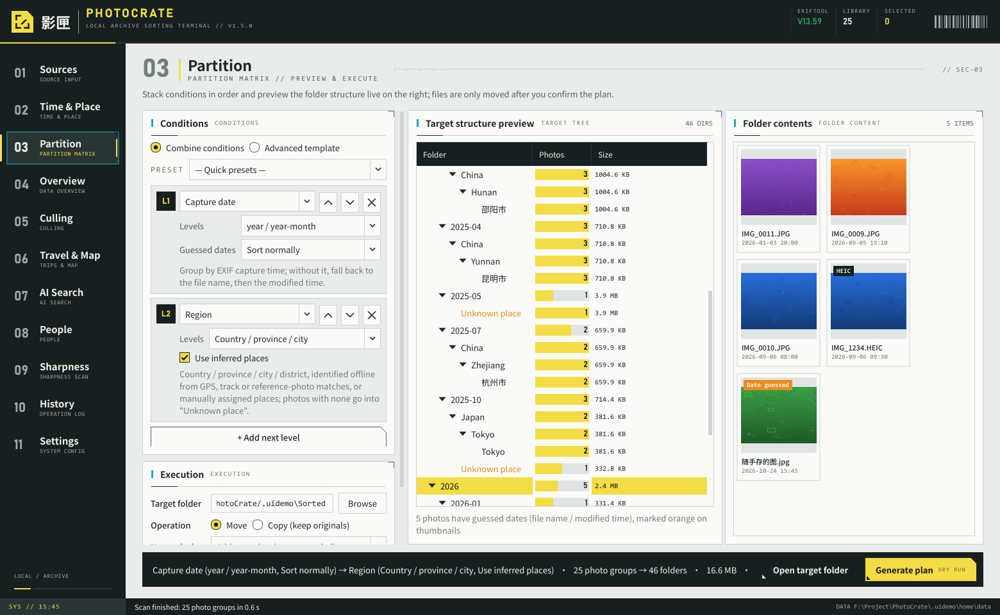
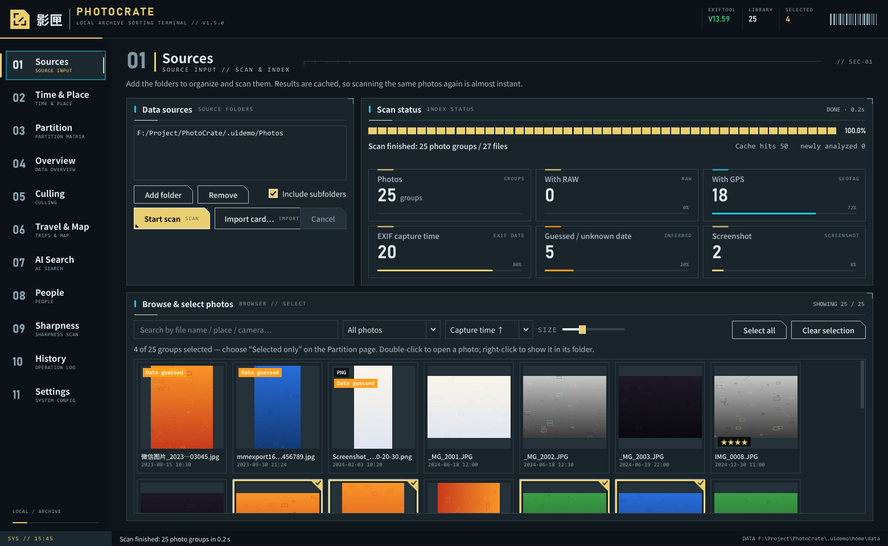
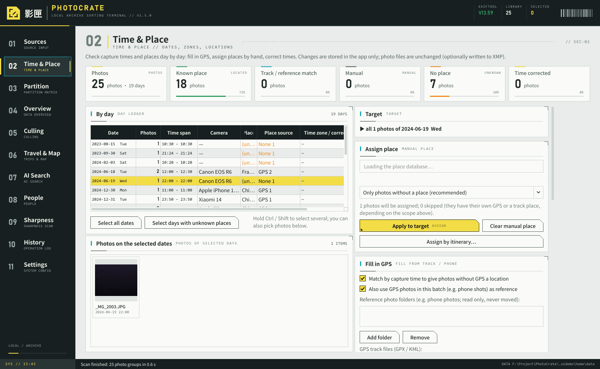
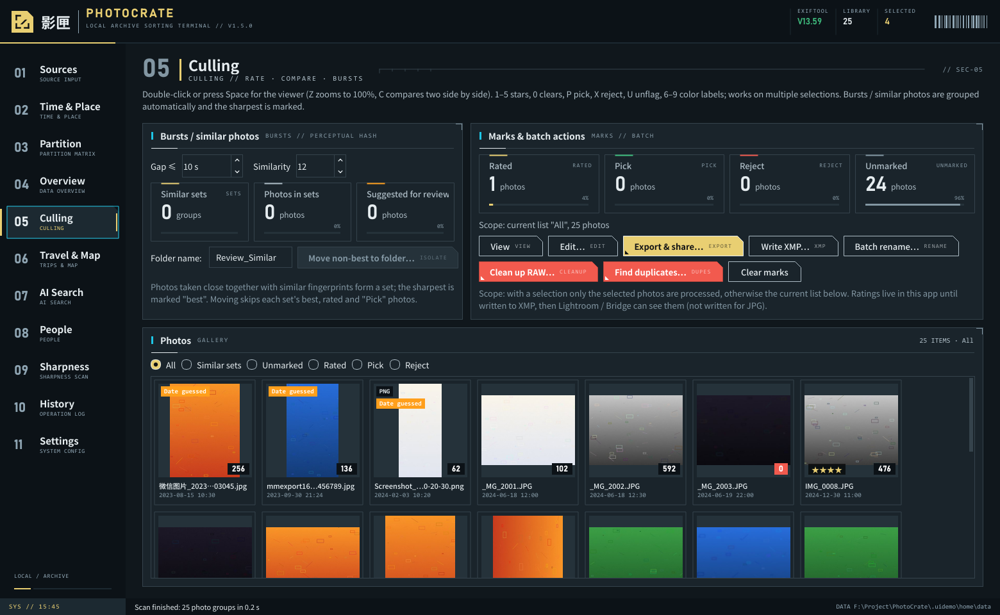
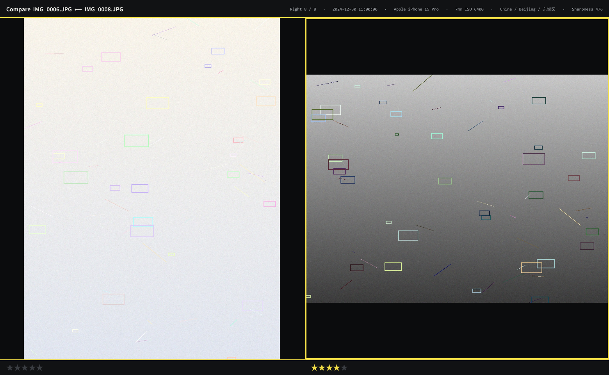
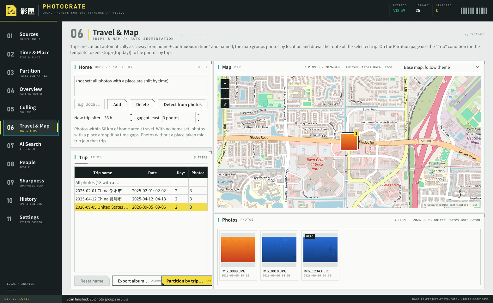
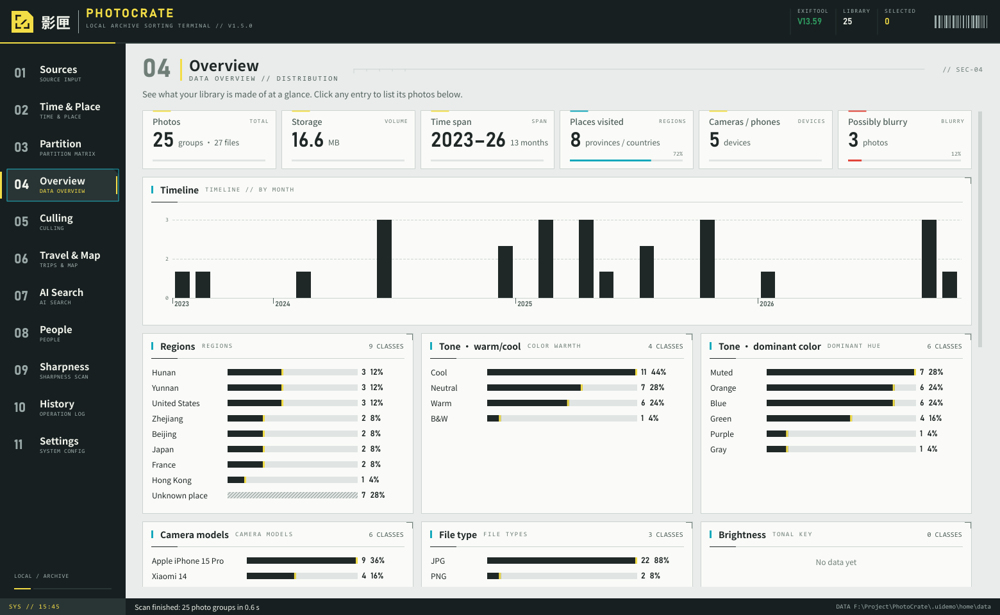
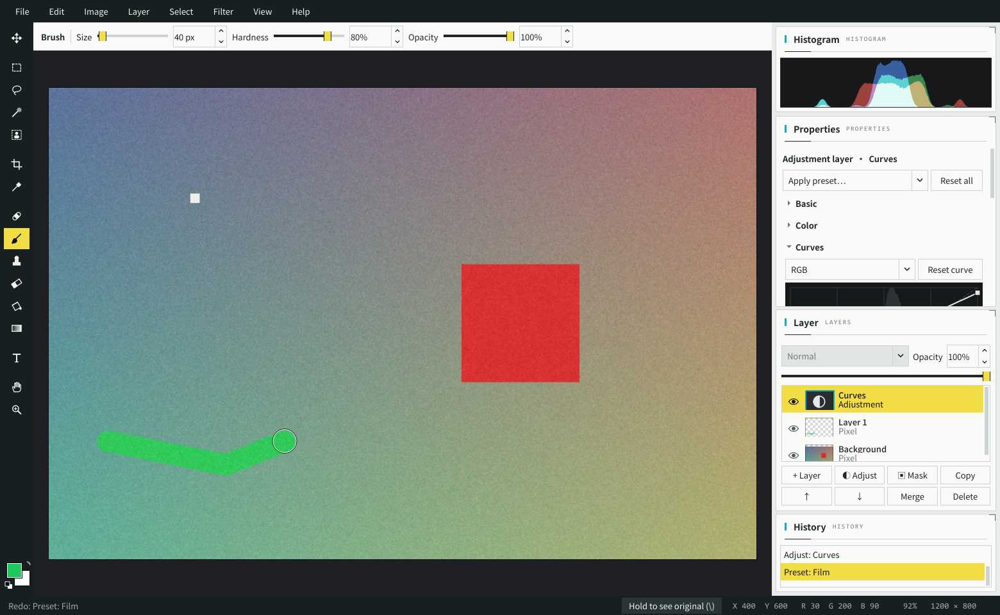
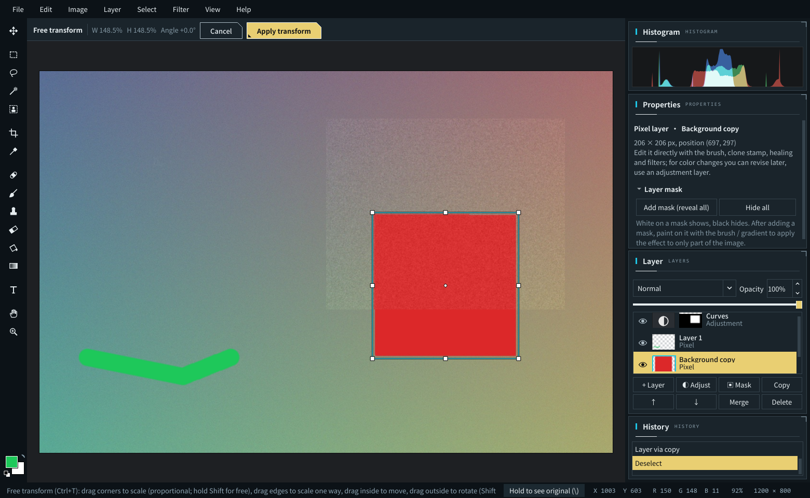
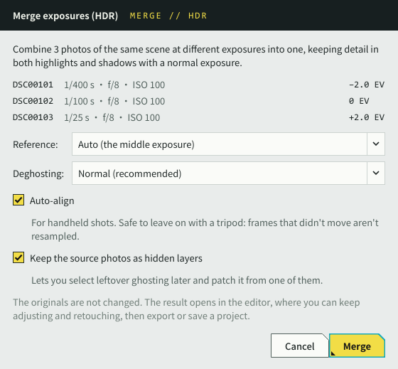
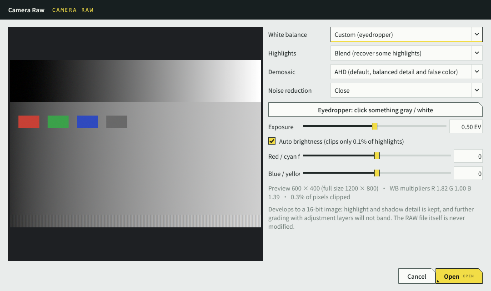
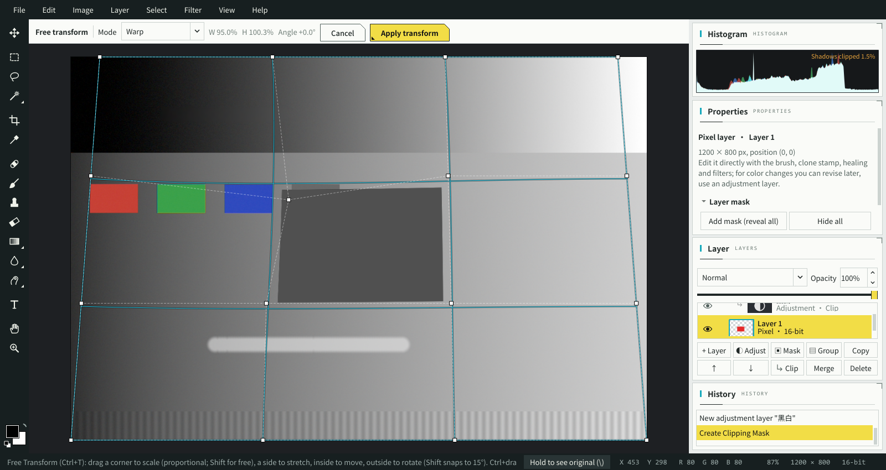
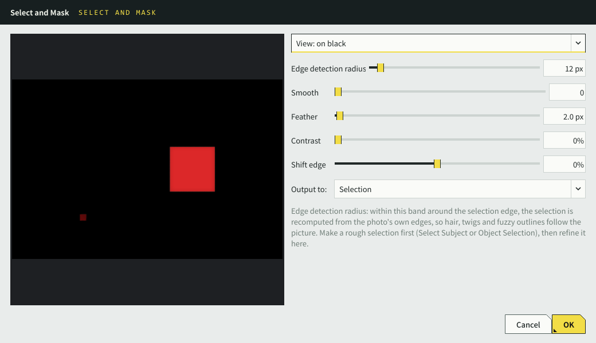
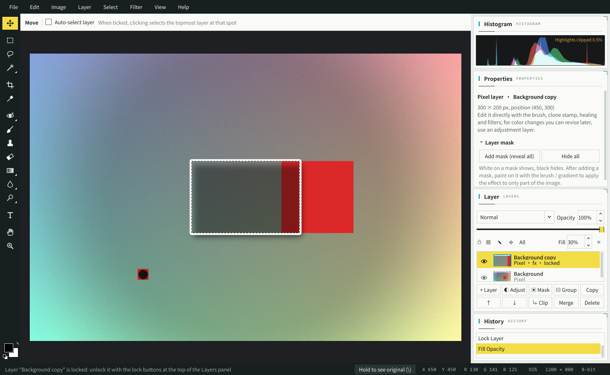
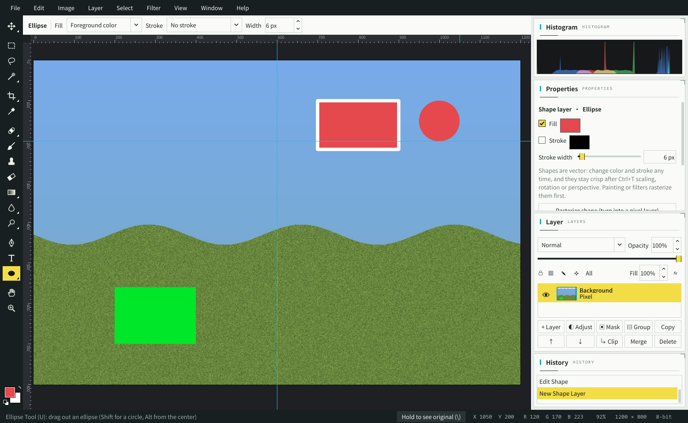
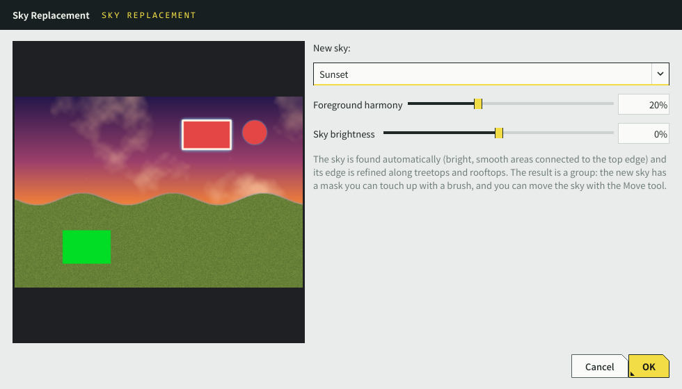

---

## 1. First run (3 steps)

1. Install **Python 3.12** from <https://www.python.org/downloads/windows/>. On the last installer screen, tick **Add python.exe to PATH**.
2. Put the whole `PhotoCrate` folder anywhere. Non-ASCII characters in the path are fine.
3. Double-click **`run.bat`**.

The first launch creates a private environment `.venv`, installs dependencies (a few minutes), downloads ExifTool, and starts the app. After that, `run.bat` opens it in seconds.

> If PowerShell says scripts are blocked: right-click `run.bat` → Run as administrator once, or run
> `Set-ExecutionPolicy -Scope CurrentUser RemoteSigned` in PowerShell.

## 2. Build an .exe (optional)

Run `run.bat` at least once, then double-click **`build_exe.bat`**:

- It produces `dist\PhotoCrate\PhotoCrate.exe`. The whole folder can be copied to another PC and run without Python.
- If [Inno Setup 6](https://jrsoftware.org/isdl.php) is installed, you also get an installer, `dist\PhotoCrate-Setup.exe`.
- `build_exe_nuitka.bat` is an alternative compiler. It starts faster but needs Python 3.12 or older, and the first build takes 10–20 minutes.
- Unsigned executables are occasionally flagged by Windows Defender; choose "Run anyway". For personal use, `run.bat` is recommended.

## 3. Pages

| Page | What it does |
|---|---|
| **01 Sources** | Add photo folders → **Start scan**. After a trip, use **Import card…** first. Pick photos in the thumbnail grid below (none selected = process all). An orange **Date guessed** tag means the photo has no EXIF time, so it was inferred from the file name or modification time. |
| **02 Time & Place** | Days are listed on the left with photo count, time span, place and place source (GPS / track / manual / none). Select days, or a few photos below, then: **Assign place** (typing a place suggests matches, e.g. `日本/京都` → Kyoto, Japan; **Assign by itinerary…** fills many days at once); **Fill in GPS** (add a phone-photo folder or GPX / KML track, then **Read references and re-match**); **Time correction** (e.g. camera set to Beijing time while in Japan → choose +08:00 → +09:00 and preview which photos change day before applying); **Write back to XMP sidecars** (optional). These edits live in the app only; photo files are untouched. |
| **03 Partition** | Stack conditions, or use a quick preset or advanced template. The middle shows the folder tree that will be created, with counts; click a folder to see its photos. Set the target folder, move or copy, name-collision handling and a separate RAW subfolder, then **Generate plan**. |
| Confirm plan | A complete source → destination list (exportable as CSV). Files are only touched after you confirm. |
| **04 Overview** | Distributions by time, region, tone, camera and more; click any entry to list its photos. |
| **05 Culling** | Select a photo and click **Edit…** (or press **E** in the viewer, or right-click a thumbnail) to open the editor; see "Photo editor" below. Double-click or press Space for the viewer: Z / double-click toggles 100% zoom at the cursor, scroll to zoom, drag to pan, C for side-by-side compare (zoom and position synced), ← → to move. On thumbnails or in the viewer: **1–5 stars, 0 clear, P pick, X reject, U unflag, 6–9 red / yellow / green / blue labels** (works on multiple selections). **Bursts / similar photos** groups by time gap plus a perceptual fingerprint and marks the sharpest as best; the rest can be moved to `Review_Similar` in one click. Buttons: **Export & share…**, **Write XMP…** (ratings / labels, optionally AI keywords), **Batch rename…**, **Clean up RAW…**, **Find duplicates…**, **Clear marks**. With a selection only the selection is processed, otherwise the current list (duplicate search always covers the whole library). Videos show ▶ and their duration; double-click or Enter plays them in the system player. |
| **06 Travel & Map** | Set one or more home locations at the top left (e.g. `Boca Raton, US`), or **Detect from photos**. Photos within 50 km of home are not trips. Away photos are split into trips by time continuity: a gap over 36 hours starts a new trip, relaxed to 72 hours while abroad; adjustable. Photos without a place that fall within a trip are included. Double-click a trip to rename it; **Partition by trip…** jumps to the Partition page with a `trip / Day N` layout; **Export album…** makes a web album. The map clusters photos by location (number = count); click a cluster to see its photos. Selecting a trip draws its route. Base map: OpenStreetMap (dimmed in the dark theme), AMap (with automatic China coordinate correction), or none. Viewed areas are cached for offline use. |
| **07 AI Search** | First click **Download** next to both models (Chinese CLIP ≈ 190 MB, faces ≈ 39 MB; a mirror can be chosen), then **Analyze all photos**. New photos are analyzed after each scan. Type a description **in Chinese** in the search box; results are ranked by relevance. Select one photo and click **Find similar**. Recognized scenes are listed on the left, and the Partition page gains a Scene condition. |
| **08 People** | Faces of the same person are grouped (avatar + count on the left). Type a name and click **Name**. Giving another group the same name merges them. Select wrongly assigned photos and click **Selected photos aren't them** so they are never assigned again. The Partition page gains a People condition: the largest named face decides; unnamed faces go to `Others`. |
| **09 Sharpness** | Drag the threshold to see in real time which photos count as blurry (red scores), and move them to `Review_Blurry` in one click. |
| **10 History** | Every move / copy / XMP write / delete-to-Recycle-Bin / rename in full. Select a batch and click **Undo this batch** to restore: moved back, `.xmp` binned or restored from backup, files returned from the Recycle Bin, names reverted. |
| **11 Settings** | Language, theme, ExifTool, file-name date rules (testable), GPS datum, inferring places by time for photos without GPS, color thresholds, plugins, cache. |

**Template examples.** `/` separates levels; `{city|province|Unknown place}` means try city, then province, then the literal text "Unknown place":

| Template | Result |
|---|---|
| `{year}/{year}-{month}` | `2026/2026-10` |
| `{year}/{year}-{month} {city\|province\|Unknown place}` | `2026/2026-10 Kyoto` |
| `{country}/{province}/{city}` | `Japan/Kyoto/Kyoto` |
| `{camera}/{ym}/{type}` | `Sony ILCE-7M4/2025-10/RAW+JPG` |
| `{year}/{warmth}/{color}` | `2025/Warm/Orange` |

Common placeholders: `year` `month` `day` `ym` (year-month) `ymd` `date` `time` `quarter` · `country` `province` `city` `district` `place` · `camera` `brand` `lens` `type` `ext` `format` · `warmth` `color` `tone` · `rating` `flag` `label` · `trip` `tripday` `scene` `person` `folder`. The partition page shows clickable chips for all of them; the Chinese names (`{年}`, `{市}`…) work too.

**Import wizard** (Sources → Import card…):
1. Inserted memory cards and disks with a `DCIM` folder are listed automatically. For a phone, connect it and **Choose folder…** its `DCIM`.
2. **Read** only reads capture times, which takes seconds. It then shows how many photos and videos are new and how many were already imported.
3. Choose the destination and a folder rule such as `{year}/{ymd}` (same syntax as partition templates), optionally with renaming.
4. Preview the list, then **Start import**.

The card is only read, never modified. Anything imported before is skipped automatically: it's in the import record `imports.db`, or the same file is already in the library. So inserting the same card again never creates duplicates. Sony videos (`PRIVATE\M4ROOT\CLIP`) are imported with their `.XML` files. Imports are logged and can be undone.

**Photo editor** (Culling → Edit…, **E** in the viewer, or right-click a thumbnail). Tools and shortcuts follow Photoshop where possible; press F1 for the full list. The first time you open it, a **guided tour** points out the toolbar, options bar, properties, layers, history and saving; replay it from **Help → Beginner Tutorial**. An illustrated walkthrough is in **[docs/editor-tutorial.en.md](docs/editor-tutorial.en.md)**.

| To… | Do this |
|---|---|
| Adjust color (editable later) | **Image → Adjust**, or **◐ Adjust** in the Layers panel: this creates an adjustment layer. Drag exposure, curves, HSL… in Properties on the right. **Apply preset…** at the top applies a look such as Film, Japanese airy or Cinematic. Adjustment layers never change pixels: edit, hide or fade them at any time. |
| Adjust only part of the photo | Make a selection first (Marquee M, Lasso L, Magic Wand / Object Selection W around the subject, Color Range, or Quick Mask Q), then create the adjustment layer; the selection becomes its mask. Or paint on the mask with a brush or gradient (white shows, black hides). |
| Remove spots, dust, wires | Paint over them with the Spot Healing Brush J. For larger objects, select them and use **Edit → Content-Aware Fill** (Shift+Backspace). The Clone Stamp S (Alt+click to sample) suits regular textures. |
| Cut out / composite | Object Selection W around the subject (refine hair with **Select → Select and Mask**) → Ctrl+J copies it to a new layer. Add another image with **File → Place Image…**, or paste with Ctrl+V. Then use Ctrl+T to scale and rotate, and change the blend mode. |
| Crop and straighten | Crop C: pick a ratio and drag the box. Hold Ctrl and drag along the horizon to straighten automatically. Press Enter to apply. |
| Add text | Text T: click to place text. Font, size, color, stroke and shadow can all be changed later. |
| Merge exposures (HDR) | Select a bracket on the Culling page → **Merge HDR…** (or right-click a thumbnail; in the editor, **File → Merge Exposures (HDR)…** picks files from disk). The middle exposure becomes the reference (never resampled); the others are aligned and deghosted, then blended with Mertens exposure fusion. The result opens in the editor with the sources kept as hidden layers. Ghost left? Select it → **Image → Fix Ghosting…**, click the preview of the cleanest source, and it's patched on a new masked layer with matched brightness. |
| RAW and 16-bit | RAW-only photos open the **Camera Raw** dialog first: white balance (with an eyedropper), exposure, highlight reconstruction, noise reduction; the result is 16-bit. For photos that also have a JPG, use **File → Re-develop RAW…**. **Image → Mode** switches between 8 and 16 bits; at 16 bits strong grading doesn't band, and PNG / TIFF exports can stay 16-bit. |
| Groups, clipping masks | Ctrl+G groups layers (collapsible; move or mask the whole group; Pass Through or isolated blending), Ctrl+Shift+G ungroups. Ctrl+Alt+G makes a clipping mask, so an adjustment layer affects only the layer below. |
| Perspective, warp | After Ctrl+T pick a **Mode** in the options bar: Skew / Distort / Perspective / Warp (4×4 grid). In Free Transform, Ctrl+drag a corner distorts and Ctrl+drag a side skews. |
| Recolor, black & white | **Image → Adjust**: Black & White, Color Balance, Selective Color, Photo Filter, Channel Mixer, Gradient Map (all adjustment layers). |
| Reshape, fix the lens | **Filter → Liquify** (forward warp, bloat, pucker…) and **Filter → Lens Correction** (distortion, fringing, vignette); Patch / Red Eye share the healing slot (Shift+J). |
| Shadows, strokes, glows | **fx** in the Layers panel: layer styles (editable any time); lock transparency / pixels / position; **Fill** fades the layer but not its styles. |
| Posters, callouts, vector shapes | Shape tools U (rectangle / rounded rectangle / ellipse / polygon / line) and the Pen P; shape layers keep editable color and stroke and never blur. Ctrl+R shows rulers — drag guides out of them; moving snaps to guides. |
| Repeated resizing, editable filters | **Layer → Smart Object → Convert to Smart Object**: transforms are recomputed from the original and filters become editable Smart Filters. |
| Same edit for many photos | **Window → Actions**: record once, then play; **Batch** plays it on many photos and saves them to another folder. |
| Panoramas, focus, skies | **File → Automate → Photomerge / Focus Stack**; **Edit → Sky Replacement** (automatic sky detection, editable group). |
| Print, hand off to Photoshop | **View → Proof Colors** (Ctrl+Y) / Gamut Warning; convert to CMYK on export; **File → Export → Save as PSD** (layers, groups and masks kept). |
| Local dodge, burn, skin smoothing | Dodge / Burn / Sponge (O, Shift+O cycles; can target shadows / midtones / highlights); Blur / Sharpen / Smudge (R, Shift+R cycles). |
| Save | **Export Image…** (Ctrl+Shift+S) flattens to JPG / PNG / TIFF / WebP, saved by default next to the original as `name_edited.jpg`. Capture time and other EXIF are kept (GPS can be removed), and exporting into a library folder triggers a rescan. **Save Project** (Ctrl+S) keeps all layers as `<name>.pcedit`; next time you edit that photo you're asked whether to continue it. |

On large images the view is computed from scaled-down proxies. While you drag a slider a low-resolution preview appears first, and a sharp frame follows when you stop. Hold `\` to see the original (background layer only).

**Find duplicates** (Culling → Find duplicates…): candidates are filtered by file size, then compared by content hash; only exact matches count. Duplicates are handled per photo group: RAW+JPG is preferred over a lone JPG, and by default the copy in the folder listed first in Sources is kept. A copy that carries edit records (`.xmp`) the original lacks is not deleted.

**Export & share** (Culling → Export & share… / Travel & Map → Export album…):
- **JPG for sharing:** long edge 1080 / 1440 / 2048 / 3840 px or original size (small images are never upscaled), quality, text watermark (position and opacity), GPS removed by default (or all EXIF), optional renaming by template, with a live preview. RAW-only photos use the camera's embedded full-size preview.
- **Web album:** a folder containing `index.html`, `photos\` and `thumbs\`. It's grouped by day, with click-to-zoom and keyboard navigation. When locations exist it shows a map and route; coordinates are rounded to about 1 km, and the map needs internet but the photos work offline. Send the folder as is or put it on a cloud drive. The album's labels follow the app language.

Exports only write new files; originals are never touched.

## 4. Safety design (why moving is safe)

1. **Preview first, confirm second:** a full list is always shown before anything runs.
2. **Journal before moving:** every operation is recorded in `%APPDATA%\PhotoCrate\journal.db` and can be undone at any time.
3. **Move as a group:** RAW+JPG, `.xmp` edit records, iPhone `.aae` edits, Live Photo `.mov` and Google Takeout `.json` travel with the photo. If any file in a group fails, the whole group is rolled back.
4. **Never overwrite:** name collisions get a number (`IMG_0001 (1).JPG`, the same number for the whole group so pairs stay together), or can be skipped.
5. **Across drives:** copy to a temp file → verify size (optionally SHA-256) → rename → only then delete the source.
6. **Interruptions:** after a crash or power loss, the next launch offers to finish or roll everything back.
7. **Deletes go to the Recycle Bin only:** RAW cleanup, undoing a copy and undoing a new `.xmp` all use the system Recycle Bin. Undoing a cleanup in History puts files back from the Recycle Bin, as long as it hasn't been emptied.
8. **Back up before editing `.xmp`:** when updating an existing `.xmp` (e.g. a Lightroom edit record), only a few fields such as rating and place are changed. A full backup is taken first and restored on undo.

## 5. FAQ

- **How do I switch between English and Chinese?** Settings → Appearance → 界面语言 · Language, then restart. Nothing is re-analyzed.
- **I sorted in Chinese and then switched to English. Will the next sort rename my folders?** Only if you sort again: new plans use English folder names (`Unknown place` instead of `未知地点`), and photos already in place under the old names are moved into the new ones. To keep the Chinese folder names, stay in Chinese for that library, or use a template with literal names.
- **RAW dates / lenses are missing?** Check that EXIFTOOL in the top-right shows a green version number. If it says OFFLINE, run `tools\get_exiftool.ps1` (right-click → Run with PowerShell) or point Settings to `exiftool.exe`.
- **Some place names are in Chinese?** Countries, Chinese provinces and places outside China are shown in English. Cities and districts inside mainland China have no offline English data and stay in Chinese.
- **Color tones sorted wrongly?** Adjust Settings → Color thresholds. The preview updates instantly without rescanning.
- **Want to re-analyze?** Settings → Clear cache, then scan again.
- **Where do F12 screenshots go?** F12 on any page saves the app window, including open dialogs, as PNG to `%APPDATA%\PhotoCrate\screenshots` (portable mode: `userdata\data\screenshots`). The path is shown in the status bar.
- **RAW and JPG in two different folders — still one photo?** Yes. A RAW and a JPG with the same name, capture times within 2 seconds and the same camera model are paired into one group during the scan. This can be turned off in Settings → Files & safety; use the **Cross-folder pairs** filter on the Sources page to view them.
- **No GPS in the camera — how to sort by region?** On Time & Place: add a phone-photo folder as a reference (read only, never moved) and locations are matched by capture time; GPX / KML tracks work too. Otherwise assign places by day.
- **Camera clock wrong / wrong time zone?** Time & Place → Time correction: select days, enter the shift (or convert, e.g. +08:00 → +09:00), check which photos move to another day, then apply. It can be cleared at any time; photo files are not changed.
- **Where are manual places and time corrections stored?** In `%APPDATA%\PhotoCrate\annotations.db`, keyed by file fingerprint, so they survive moves. Clearing the cache does not delete them.
- **Where is data stored?** Settings, logs, the operation journal and manual places / time corrections are in `%APPDATA%\PhotoCrate`. Thumbnails and the feature cache are in `%LOCALAPPDATA%\PhotoCrate`. Put an empty `portable.flag` file in the program folder for portable mode (data in `userdata\`).
- **Rated photos, but Lightroom doesn't show the stars?** Ratings live in the app (`annotations.db`) until you use Culling → Write XMP…, which writes them to the `.xmp` next to each RAW. In Lightroom, right-click → Metadata → Read Metadata from File; Bridge refreshes automatically. "Reject" is written as Rating = -1 (Bridge shows "Rejected"). "Pick" has no standard XMP field and stays in the app. JPGs get no `.xmp`.
- **Similar-photo groups too fine / too coarse?** On Culling, adjust **Gap** (default 10 s) and **Similarity** (default 12; smaller is stricter). Groups update instantly.
- **Regret a RAW cleanup?** In History, select that "delete to Recycle Bin" batch → **Undo this batch**. Files return from the Recycle Bin and the library rescans. You can also restore them from the Windows Recycle Bin directly.
- **Does the AI upload my photos?** No. Models are downloaded once to `%APPDATA%\PhotoCrate\models` (portable: `userdata\data\models`) and run fully offline; only model downloads and map tiles need internet. You can also place the model files there by hand (file names are listed on the AI Search page).
- **How long does AI analysis take?** Scenes and search use thumbnails, about 0.1 s per photo on a normal CPU. Face detection happens during scanning. Results are cached once and survive moves and renames.
- **Why must AI search be typed in Chinese?** The bundled model is Chinese CLIP, trained on Chinese captions. It is good at "scene + object + mood" (海边日落 "sunset at the beach", 下雪的神社 "snowy shrine", 红色的跑车 "red sports car") but doesn't know specific people or shop names; sentence-like descriptions work best. Scores are only comparable within one search. Only plausible results are shown, so you may get fewer than "top N".
- **How does "find similar" compare?** It looks at both content (what the AI thinks is pictured) and appearance (color, brightness, composition). Bursts at the same spot in the same light rank first; similar content shot day vs. night ranks lower or is hidden. The percentage is the combined similarity; below 30% is hidden. The target photo is shown above the results, and **Compare in viewer** steps through them in the viewer (press C for side by side).
- **How do I page in the viewer?** ← → on the keyboard, or move the mouse to the left / right edge and click the arrow.
- **People grouped wrongly?** Raise **Similarity** at the bottom of the People page to be stricter: different people mix less, but one person may split into two groups (give both the same name to merge). Lower it for the opposite. Profile faces and very small faces (under 40 px in the preview) are ignored.
- **Deer, cats, dolls or anime characters among People?** The face detector only checks whether something looks like a face. The app then asks the AI whether each face is a real human; non-human ones go to **Not a face** at the end of the list and are excluded from grouping (requires the Chinese CLIP model). Missed one? Select photos and click **Not a face** (no selection = whole group). Wrongly excluded? Select it under **Not a face** and click **Is a face (restore)**. Real people on posters or billboards can be marked the same way.
- **Trips not detected / home photos counted as trips?** Set your home on Travel & Map first. Photos without GPS need places filled in on Time & Place (phone photos / tracks / manual); otherwise trips can only be split by time.
- **Map is blank?** Base maps need internet (OpenStreetMap can be slow in mainland China; switch to AMap). Photos need a location (GPS, track match or manual place) to appear; manually assigned places show at the city center.
- **How do I import from a phone?** Android: connect by USB in "File transfer" mode, then in the import wizard choose **Choose folder…** and pick the phone's `DCIM`. iPhone: export to a folder first with the Windows Photos app or iCloud, then import from that folder (an iPhone can't be accessed as a drive).
- **Video times off by hours?** Phone and camera videos usually store UTC. The app finds the nearest photo with a known time zone and converts accordingly; hovering the thumbnail shows "Time zone inferred from nearby photo". With no photo within 24 hours, the PC's time zone is used; correct it on Time & Place if needed.
- **What do XMP keywords look like in Lightroom?** Plain keywords are scene names (e.g. "Night scenes"), people and trip names. Hierarchical keywords are like `Scenes|City & architecture|Night scenes`, `People|<name>` and `Trips|<trip name>`, in the app language at the time of writing. Only names this app recognized or you assigned are written; existing keywords are kept and nothing is duplicated.
- **Want to re-sort differently later (date first, camera or rating later)?** Change the conditions on Partition and generate a new plan; the target can be the same folder as before. When you move into a folder outside your sources, it's added to Sources automatically, so photos don't "disappear" on the next scan. Empty folders left behind (like `2026-01-05`) are removed, but source folders themselves are kept, and photos already in place are skipped. Ratings, manual places, time corrections and AI results follow the photos, so nothing is recomputed.
- **Sorted twice and want to undo the first?** Select the first batch in History → Undo. You'll be told it was moved again by batch #N; confirm, and both are undone newest to oldest. Photos return to where they were before the first sort, and removed empty folders are recreated.
- **Does merging exposures soften the photo?** No. The reference frame (the middle exposure) is not resampled at all. The others are aligned to about 0.05–0.1 pixel in the synthetic tests, and tripod shots that didn't move aren't resampled either; the blend favors whichever frame is sharper. In the tests the merged result is at least as sharp as the reference (`tests/test_hdr.py`).
- **What about ghosts when merging?** Deghosting is on by default: wherever something moved between shots, only the reference is used — including areas the reference has clipped but the other frames show. Anything left can be selected with the Lasso and patched via **Image → Fix Ghosting…**.
- **Does editing change the original?** No. Everything in the editor happens in memory. Export writes a new file and refuses to overwrite the original; Save Project writes a `.pcedit`. A `.pcedit` with the same name as the original is treated as a sidecar and moves and renames with the photo.
- **What is a `.pcedit`?** A zip with `document.json` (layer structure, adjustment settings, text) plus one PNG per layer. Open it with any unzip tool to get individual layers.
- **Can I edit RAW?** RAW files open, but from the camera's embedded full-size JPEG preview (the same as Export & share), not a fresh RAW decode. Highlight / shadow recovery headroom is therefore the same as a JPG. For maximum RAW latitude, develop in Lightroom or similar first.
- **Is the editor fast?** For a 24-megapixel photo: about 30 ms per preview frame while dragging a slider (low resolution first), only the visible area is computed at 100% zoom, and a full export takes about 2–3 seconds. The magic wand samples the current layer by default ("sample all layers" is slower the first time).
- **Will batch rename break RAW+JPG pairs?** No. A whole group (RAW + JPG + `.xmp`) gets the same base name; only names change, not folders. Collisions get " (1)". Ratings, manual places and time corrections follow the new names.

## 6. Development & extension

- Architecture and plugin API: **[ARCHITECTURE.md](ARCHITECTURE.md)** (in Chinese).
- Interface text: Chinese source strings are wrapped in `t()` (`photocrate/i18n.py`); English lives in `photocrate/locale_en.py` (`EN` table, keyed by the Chinese text, with `{0}` placeholders). A missing entry simply shows the Chinese text.
- Example plugins: `plugins_examples\` (a file-size partition with a custom page, and an AI scene-classifier skeleton).
- Tests: `.venv\Scripts\python -m pytest tests -q` (`tests\test_i18n.py` covers the English table and English folder / template output). XMP write-back cases need the environment variable `PHOTOCRATE_TEST_EXIFTOOL` pointing to `exiftool.exe`.
- UI automation: `tests\ui_timeplace.py`, `tests\ui_culling.py`, `tests\ui_tier3.py`, `tests\ui_workflow.py`, `tests\ui_repartition.py` and `tests\ui_editor.py` (the editor; its core unit tests are in `tests\test_editor.py`), `tests\ui_editor_pro.py` (Camera Raw, 16-bit, groups, perspective / warp, retouching tools; core tests in `tests\test_editor_pro.py`), `tests\ui_editor_pro2.py` (Select and Mask, new adjustments, Liquify, Patch, layer styles; core tests in `tests\test_editor_pro2.py`), `tests\ui_editor_pro3.py` (pen, shapes, smart objects, guides, actions, proofing, sky replacement, PSD; core tests in `tests\test_editor_pro3.py`), `tests\ui_merge.py` (merge exposures; engine tests in `tests\test_hdr.py`; run with `PHOTOCRATE_LANG=en` to exercise the English UI). Face cases need `PHOTOCRATE_TEST_MODELS` pointing to a folder with the YuNet / SFace models. The real-model "not a human face" case also needs `PHOTOCRATE_TEST_CLIP` pointing to a folder with the Chinese CLIP model.
- Generate test photos: `.venv\Scripts\python tests\make_samples.py D:\TestPhotos`

## 7. Data & third-party licenses

- ExifTool © Phil Harvey (Perl Artistic / GPL), downloaded at run time and not distributed with the source.
- Chinese administrative divisions come from GeoToolCN (code: MIT). Its boundary data is derived from DataV.GeoAtlas / AMap Open Platform and is marked "for learning and exchange only": fine for personal use, but **obtain permission before any commercial distribution**.
- Cities outside China: GeoNames (CC BY 4.0), in `data\geonames_cities1000.csv.gz`; the population field comes from geonamescache (MIT). English country names come from Qt's locale data.
- AI models (not distributed with the source; downloaded on first use): a quantized ONNX build of Chinese-CLIP (OFA-Sys, MIT; converted by Xenova); face models YuNet (MIT) and SFace (Apache 2.0) from OpenCV Zoo; inference with onnxruntime (MIT). `data\clip_vocab_zh.txt` is the Chinese-CLIP vocabulary.
- Base maps: © OpenStreetMap contributors (ODbL) and © AMap, loaded online under their respective terms, for personal viewing only.
- PySide6 (LGPL), rawpy / LibRaw (MIT / LGPL), pillow-heif (BSD / LGPL), OpenCV (Apache 2.0).
