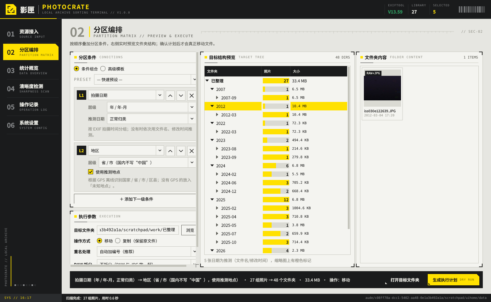
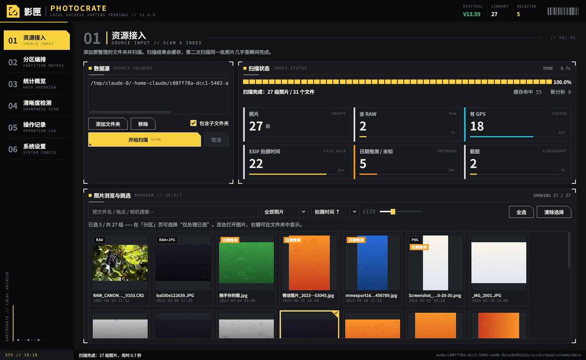
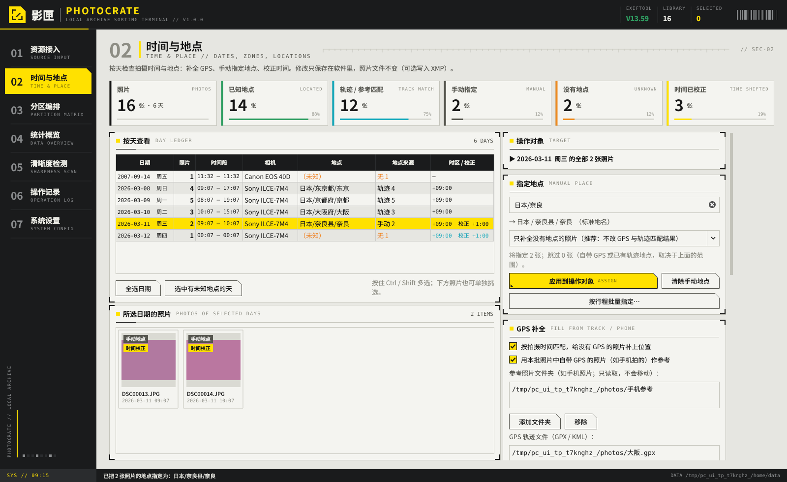
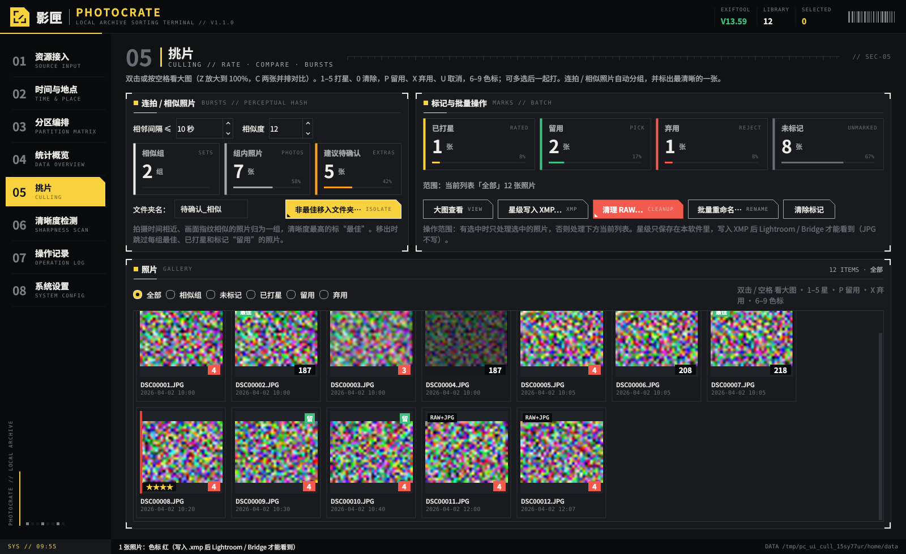
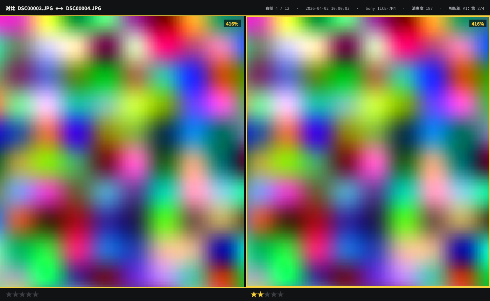
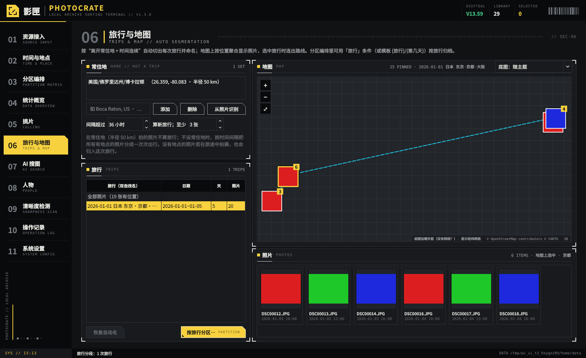
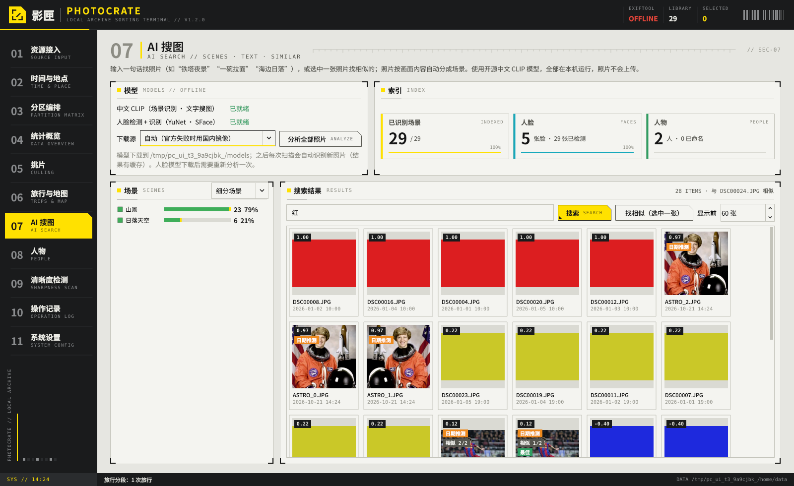

# 影匣 PhotoCrate

本地照片分区整理终端（Windows 桌面应用）。在软件里选好分区条件、预览文件夹结构，确认后把照片**真正移动**到对应文件夹；每次操作都有日志，可一键撤销。

- **分区条件**（可最多 4 级嵌套，或用模板自由组合）：拍摄日期 · 地区（国家/省/市/区县）· 色调（冷暖/主色/明暗）· 相机 · 镜头 · 文件类型（可把 RAW 与 JPG 分开放进 ARW/、JPG/）· 横竖幅 · 来源（相机/手机/截图）· 清晰度 · 焦段 · ISO · 分辨率 · 原文件夹名
- **格式**：JPG、PNG、HEIC、TIFF、WebP，几乎所有相机 RAW（CR2/CR3/NEF/ARW/RAF/ORF/RW2/DNG/PEF…），以及视频（MP4/MOV/MTS/M2TS/AVI/MKV…，跟着日期、旅行一起归档）
- **时间与地点**：按天查看拍摄时间与地点；手动 / 按行程批量指定地点；用手机照片或 GPX/KML 轨迹按拍摄时间（自动换算时区）补全 GPS；相机时间 / 时区校正（先预览再应用）；可选把结果写回 RAW 的 .xmp 附属文件
- **RAW 与 JPG 分开存放也能认出是同一张**（按文件名 + 拍摄时间跨文件夹配对）
- **挑片**：大图查看（100% 看对焦、两张并排对比、缩放同步）；键盘 1–5 打星、P 留用 / X 弃用、6–9 色标，可写进 .xmp 给 Lightroom / Bridge；连拍 / 相似照片自动分组并标出最清晰的一张，其余可一键移到「待确认」
- **清理 RAW**：“只保留 JPG”或“删掉没打星的 RAW”，一律进回收站、可撤销；**批量重命名**（`{日期}_{城市}_{序号}`，RAW 与 JPG 同名，可撤销）
- **旅行与地图**：按“离开常住地 + 时间连续”自动切出每次旅行并命名（「2026-01-01 日本 东京·京都·大阪」，可改名），可按「旅行 / 第几天」分区；内置地图按位置聚合显示照片、连出旅行路线
- **AI 搜图**（本机离线运行）：中文 CLIP 自动识别场景（山景、海边、夜景、美食、人像…），输入“铁塔夜景”“一碗拉面”这样的中文找照片，或选一张找相似的
- **人物分组**：自动把同一个人的脸归成一组，起名后以后的照片自动认出，可按人物分区
- **导入向导**：插上存储卡 / 连上手机 → 复制到电脑（跳过以前导入过的）→ 按「年 / 日期」等规则建文件夹、可顺便改名 → 自动加入照片库
- **重复照片清理**：按文件内容找出复制了好几份的照片（改了名也能认出），每组留一份，其余进回收站、可撤销
- **导出与分享**：一键导出发朋友圈 / 小红书的 JPG（缩小、加水印、去掉 GPS）；把一次旅行做成网页相册（按天分组 + 地图路线，双击打开）；场景 / 人物 / 旅行名可作为关键词写进 .xmp，Lightroom 里能搜
- **其他功能**：统计概览（点任意条目查看对应照片）、模糊照片检测、操作记录与撤销、崩溃恢复、插件扩展、**F12 一键截图**、记住窗口位置（多显示器）
- **界面**：工业科幻终端风格，浅色「终末地」/ 深色「方舟」两套主题（设置里切换）；导航滑动标记、短暂切页淡入、按钮反馈与进度扫光，可在「系统设置 → 外观 → 界面动效」即时关闭。小窗口下资源接入区支持滚动。
- **隔离预览**：运行 `.venv\Scripts\python scripts\preview_ui.py --hold`，使用临时测试图片查看两套主题，不读取现有照片库。截图保存到 `docs/ui-review/`。

---

## 一、第一次运行（3 步）

1. 安装 **Python 3.12**：<https://www.python.org/downloads/windows/>
   安装界面最下方务必勾选 **Add python.exe to PATH**。
2. 把整个 `PhotoCrate` 文件夹放到任意位置（路径里有中文也没关系）。
3. 双击 **`run.bat`**。

第一次会自动：创建独立运行环境 `.venv` → 安装依赖（几分钟，国内网络会自动改用清华镜像）→ 下载 ExifTool → 启动程序。以后再双击 `run.bat` 几秒就能打开。

> 如果 PowerShell 提示脚本被阻止：右键 `run.bat` → 以管理员身份运行一次，或在 PowerShell 中执行
> `Set-ExecutionPolicy -Scope CurrentUser RemoteSigned`。

## 二、打包成 exe（可选）

先至少运行过一次 `run.bat`，然后双击 **`build_exe.bat`**：

- 生成 `dist\PhotoCrate\PhotoCrate.exe`（文件夹形式，整个文件夹可以拷到别的电脑直接运行，不需要装 Python）。
- 如果电脑装了 [Inno Setup 6](https://jrsoftware.org/isdl.php)，还会额外生成安装包 `dist\PhotoCrate-Setup.exe`。
- `build_exe_nuitka.bat` 是另一种编译方式（启动更快，但需要 Python 3.12 及以下，首次编译 10~20 分钟）。
- 没有代码签名的 exe 偶尔会被 Windows Defender 拦截，选“仍要运行”即可；自己用的话推荐直接用 `run.bat`。

## 三、使用流程

| 页面 | 做什么 |
|---|---|
| **01 资源接入** | 添加照片文件夹 → 开始扫描；旅行回来先点 **导入存储卡…**（见下方“导入向导”）。下方缩略图可以挑选照片（不选＝处理全部）。橙色「日期推测」标签表示该照片没有 EXIF 时间，是从文件名或修改时间推测的。 |
| **02 时间与地点** | 左边按天列出照片数、时间段、地点、地点来源（GPS / 轨迹 / 手动 / 无）。选中日期（或下方挑几张照片）后：**指定地点**（输入“日本/京都”有候选，或“按行程批量指定”一次写多天）；**GPS 补全**（添加手机照片文件夹或 GPX/KML 轨迹，点“读取参考并重新匹配”）；**时间校正**（例：相机设成北京时间去了日本 → 选“+08:00 → +09:00”换算，预览哪些照片会跨天后再应用）；**写回 XMP**（可选）。这些修改只保存在软件里，照片文件不变。 |
| **03 分区编排** | 叠加分区条件（或选「快速预设」/「高级模板」），中间实时显示将要生成的文件夹树和每个文件夹的照片数，点击文件夹在右侧看照片。设置目标文件夹、移动/复制、重名处理、RAW 是否单独放子文件夹，然后点 **生成执行计划**。 |
| 确认计划 | 弹出完整的「源 → 目标」清单（可导出 CSV），确认后才真正动文件。 |
| **04 统计概览** | 时间、地区、色调、相机等分布图；点任意条目，下方列出对应照片。 |
| **05 挑片** | 双击或按空格看大图：Z / 双击放大到 100%（以鼠标处为中心）、滚轮缩放、拖动平移，C 两张并排对比（缩放和位置同步，点哪边哪边是“当前”），← → 翻页。缩略图上或大图里按 **1–5 打星、0 清除、P 留用、X 弃用、U 取消、6–9 红黄绿蓝色标**（可多选一起打）。上方「连拍 / 相似照片」按时间间隔 + 画面指纹分组，清晰度最高的标“最佳”，其余可一键移入「待确认_相似」。按钮：**导出分享**、**写入 XMP**（星级 / 色标，可带 AI 关键词）、**批量重命名**、**清理 RAW**、**查找重复照片**、清除标记——有选中时只处理选中的，否则处理当前列表（查找重复总是查整个照片库）。视频缩略图右下角显示 ▶ 时长，大图里双击或回车用系统播放器播放。 |
| **06 旅行与地图** | 左上设“常住地”（可多个，如 `Boca Raton, US`、`湖南/邵阳`，或点“从照片识别”）。在常住地 50 km 内拍的照片不算旅行；离家的照片按时间连续性自动分成一次次旅行（间隔超过 36 小时算两次，人还在国外时放宽到 72 小时，可调），没有地点的照片若在旅途中拍摄也会归进去。旅行列表双击改名；点“按旅行分区…”直接到分区页生成「旅行 / 第几天」结构；点“导出相册…”把选中的旅行做成网页相册。右边地图按位置聚合显示照片（数字＝张数），点一堆在下方看照片、双击放大；选中一次旅行时按时间连出路线。底图默认 OpenStreetMap（深色主题下自动压暗），也可选高德（中国境内自动纠偏）或不显示；看过的区域会缓存，离线也能看。 |
| **07 AI 搜图** | 第一次用先点两个模型旁边的“下载”（中文 CLIP 约 190 MB、人脸约 39 MB，“下载源”可选国内镜像），然后点“分析全部照片”；以后每次扫描自动分析新照片。上方搜索框输入中文描述，结果按相关度排序（分数越高越像）；选中一张点“找相似”。左边是自动识别的场景分布，点一个场景看对应照片；分区页多了「场景」条件。 |
| **08 人物** | 自动把同一个人的脸归成一组（左边头像 + 张数），选中一组在右边看照片。输入名字点“命名”；把另一组也起同样的名字＝合并成一个人；选中认错的照片点“选中的照片不是 TA”，以后不再归给他。分区页多了「人物」条件（按照片里最大的那张已命名的脸归档，未命名的放“其他人”）。 |
| **09 清晰度检测** | 拖动阈值，实时看哪些照片被判为模糊（红色分数），可一键移入「待确认_模糊」文件夹。 |
| **10 操作记录** | 每次移动 / 复制 / 写入 XMP / 删除到回收站 / 重命名 的完整清单；选中批次点「撤销此批次」即可恢复（移回原处、.xmp 进回收站或换回备份、从回收站放回、改回原名）。 |
| **11 系统设置** | 主题、ExifTool、文件名日期规则（可测试）、GPS 坐标系、无 GPS 照片按时间推测地点、色调阈值、插件、缓存。 |

**高级模板示例**（`/` 分隔层级，`{市|省|未知地点}` 表示依次尝试）：

| 模板 | 结果 |
|---|---|
| `{年}/{年}-{月}` | `2026/2026-10` |
| `{年}/{年}-{月} {市\|省\|未知地点}` | `2026/2026-10 邵阳市` |
| `{国家}/{省}/{市}` | `中国/湖南省/邵阳市` |
| `{相机}/{年月}/{类型}` | `Sony ILCE-7M4/2025-10/RAW+JPG` |
| `{年}/{冷暖}/{主色}` | `2025/暖色调/橙` |

**导入向导**（资源接入 → 导入存储卡…）：自动列出插着的存储卡 / 带 DCIM 文件夹的磁盘（手机：连上后选手机里的 DCIM 文件夹）→ “读取”（只读拍摄时间，几秒钟）→ 显示新照片 / 新视频 / 已导入的张数 → 选“导入到”的文件夹和文件夹规则（如 `{年}/{年月日}`，与分区模板写法相同），可勾选“同时改名” → 预览清单 → 开始导入。只复制、不改动存储卡；以前导入过的（导入记录 `imports.db`，或照片库里已有同一个文件）自动跳过，所以同一张卡插几次都不会重复；索尼视频（`PRIVATE\M4ROOT\CLIP`）连同 .XML 一起导入。导入记在「操作记录」里，可撤销。

**查找重复照片**（挑片 → 查找重复照片…）：先按文件大小筛选，大小相同的再比对内容哈希，完全一致才算重复；以“照片组”为单位，RAW+JPG 比单独的 JPG 优先保留，默认保留「资源接入」里排在前面的文件夹中的那份。副本带有原件没有的修图记录（.xmp）时不删。

**导出与分享**（挑片 → 导出分享… / 旅行与地图 → 导出相册…）：分享用 JPG = 长边 1080 / 1440 / 2048 / 3840 或原尺寸（小图不放大）、质量、文字水印（位置 + 透明度）、默认去掉 GPS（可去掉全部 EXIF）、可按模板改名，右边实时预览；只有 RAW 的照片用相机内嵌的全尺寸预览。网页相册 = 一个文件夹（`index.html` + `photos\` + `thumbs\`），按天分组、点图放大、键盘翻页，有位置时显示地图和路线（坐标只保留到约 1 km，地图需要联网，照片本身离线也能看），整个文件夹可以直接发给别人或放到网盘。导出只写新文件，不动原片。

## 四、安全设计（为什么可以放心移动）

1. **先预览、再确认**：执行前一定会弹出完整清单。
2. **先写日志再移动**：所有操作记录在 `%APPDATA%\PhotoCrate\journal.db`，可随时撤销。
3. **成组移动**：RAW+JPG、`.xmp` 修图记录、iPhone 的 `.aae` 编辑记录、实况照片 `.mov`、Google 导出的 `.json` 跟随照片一起移动；一组中任何一个文件失败，整组退回原处。
4. **绝不覆盖**：重名时自动加编号（`IMG_0001 (1).JPG`，同组文件用同一个编号保持配对），也可选择跳过。
5. **跨磁盘**：先复制为临时文件 → 校验大小（可选 SHA-256）→ 改名 → 才删除源文件。
6. **意外中断**：程序崩溃或断电后再次打开，会提示「继续完成」或「全部回滚」。
7. **删除只进回收站**：清理 RAW、撤销“复制”、撤销新建的 .xmp，文件都进系统回收站；在「操作记录」撤销清理时，软件会从回收站把文件放回原处（回收站清空之前都可以）。
8. **改写 .xmp 先备份**：更新已有的 .xmp（Lightroom 修图记录）时只改星级 / 地点等几个字段，改之前完整备份，撤销时原样换回。

## 五、常见问题

- **RAW 的日期/镜头读不到？** 看左上角 EXIFTOOL 是否为绿色版本号；若显示 OFFLINE，运行 `tools\get_exiftool.ps1`（右键 → 使用 PowerShell 运行）或在设置里指定 `exiftool.exe`。
- **海外地名是英文？** 国家名都有中文，常见的州/县/城市也已翻译；其余保留英文。可在 `data\place_names_zh.json` 里自行补充。
- **色调分得不准？** 在设置 → 色调阈值里调整，预览即时刷新，不用重新扫描。
- **想重新分析？** 设置 → 清空缓存，然后重新扫描。
- **F12 截图存在哪？** 在任意页面按 F12，会把软件窗口（连同弹出的对话框）存为 PNG：`%APPDATA%\PhotoCrate\screenshots`（便携模式在程序目录 `userdata\data\screenshots`），保存路径会显示在底部状态栏。
- **RAW 和 JPG 分开放在两个文件夹，还算一张吗？** 算。扫描时会把“同名、拍摄时间相差 2 秒以内、机型相同”的 RAW 与 JPG 重新配成一组（设置 → 文件与安全 可关闭）。资源接入页的筛选里选「跨文件夹配对」可以查看。
- **相机没有 GPS，怎么按地区分？** 到「时间与地点」页：有手机照片就把手机照片文件夹加为参考（只读取，不移动），软件按拍摄时间自动配上位置；有 GPX/KML 轨迹（如两步路、Google 时间线导出）也可以；都没有就按天手动指定地点。
- **相机时间不准 / 时区设错了？** 「时间与地点」→ 时间校正，选中日期后输入要推后 / 提前的时间（或用“+08:00 → +09:00”换算），预览会列出哪些照片跨天，确认后才生效；随时可以清除。照片文件本身不改。
- **手动地点和时间校正存在哪？** `%APPDATA%\PhotoCrate\annotations.db`（跟随照片的文件指纹，移动照片后依然有效；清空缓存不会删除它）。
- **数据存在哪？** 设置/日志/操作记录/手动地点与时间校正：`%APPDATA%\PhotoCrate`；缩略图与特征缓存：`%LOCALAPPDATA%\PhotoCrate`。在程序目录放一个空文件 `portable.flag` 可改为便携模式（数据存在程序目录 `userdata\`）。

- **星级打了，Lightroom 里看不到？** 星级先只保存在软件里（`annotations.db`），点「挑片 → 星级写入 XMP」才会写到 RAW 旁边的 .xmp。Lightroom 里对照片右键 → 元数据 → 从文件读取元数据；Bridge 会自动刷新。“弃用”写成 Rating = -1（Bridge 显示为“拒绝”）；“留用”在 XMP 里没有标准字段，只保存在软件里。JPG 不写 .xmp。
- **相似照片分得太碎 / 太粗？** 「挑片」页左上调“相邻间隔”（默认 10 秒）和“相似度”（默认 12，越小越严格），立即重新分组。
- **清理 RAW 后后悔了？** 「操作记录」选中那次“删除到回收站”→ 撤销此批次，文件从回收站放回原处并自动重新扫描。也可以直接在 Windows 回收站里还原。
- **AI 会把照片传到网上吗？** 不会。模型下载到本机（`%APPDATA%\PhotoCrate\models`，便携模式在 `userdata\data\models`）后完全离线运行；只有下载模型和地图底图需要联网。也可以手动把模型文件放进这个文件夹（文件名见「AI 搜图」页的说明）。
- **AI 分析要多久？** 场景 / 搜图用缩略图计算，普通 CPU 每张约 0.1 秒；人脸检测在扫描时顺带做。结果都有缓存，只算一次，照片移动、改名后不用重算。
- **搜不准？** 中文 CLIP 擅长“场景 + 物体 + 氛围”（“海边日落”“下雪的神社”“红色的跑车”），不认识具体的人名和店名；描述越像一句话越好。分数只能在同一次搜索里比较。搜索结果只显示“像样”的：一张照片如果明显拍的是别的主体（比如搜“街道”时的特写人像、一碗面），会被去掉，所以结果可能少于“显示前 N 张”。
- **找相似是怎么比的？** 同时看内容（AI 认为画的是什么）和画面（颜色、明暗、构图）：同一处连拍、相同光线的排最前，内容相近但一张白天一张夜里的排后面或不显示。百分比是综合相似度，低于 30% 的不显示。结果上方会显示目标照片，点「大图对比」可以在大图里和结果逐张对照（按 C 并排）。
- **大图里怎么翻页？** 键盘 ← →，或者把鼠标移到照片左右两侧，点出现的箭头。
- **人物分错了？** 「人物」页右下的“相似度”调高 = 更严格（不同的人不容易混在一起，但同一个人可能被分成两组，起同一个名字即可合并）；调低则相反。侧脸、很小的脸（预览图里小于 40 像素）会被忽略。
- **人物里出现了鹿、猫、玩偶、动漫人物？** 人脸检测器只认“像不像一张脸”，动物、玩偶、手办、雕像、动漫人物都可能被框出来。软件会再用 AI 判断每张脸是不是真人，不是的归到列表最后的「不是人脸」，不参与分组（需要已下载中文 CLIP 模型）。漏掉的：选中照片点「不是人脸」（不选照片 = 整组都不是）；判断错的：在「不是人脸」里选中照片点「是人脸（恢复）」。海报、广告牌上的真人照片 AI 也会当成人脸，可以用同样的方法标掉。
- **旅行没分出来 / 把在家拍的也算成旅行？** 先在「旅行与地图」设常住地；没有 GPS 的照片要先在「时间与地点」补全地点（手机照片 / 轨迹 / 手动），否则只能按时间分段。
- **地图是空白的？** 底图需要联网（OpenStreetMap 在国内可能较慢，可换成高德）；照片要有位置（GPS、轨迹匹配或手动地点）才会出现在地图上，手动指定的地点按城市中心显示。
- **手机怎么导入？** 安卓：USB 连接选“文件传输”，在导入向导里“选择文件夹…”选手机里的 `DCIM`。iPhone：Windows 上用“照片”应用或 iCloud 先导出到一个文件夹，再从那个文件夹导入（iPhone 不能直接作为磁盘访问）。
- **视频的时间差了几个小时？** 手机 / 相机视频里的时间多半是 UTC，软件会找拍摄时间最接近、时区已知的照片，按它的时区换算（悬停缩略图能看到“时区按附近照片推断”）；24 小时内没有照片时按电脑时区显示，可在「时间与地点」里校正。
- **关键词写进 XMP 后在 Lightroom 里叫什么？** 普通关键词就是场景名（如“夜景”）、人物名、旅行名；层级关键词是“场景|城市建筑|夜景”“人物|张三”“旅行|2026-01-01 日本…”。只写本软件识别 / 命名过的，已有的关键词保留不动，重复写入不会重复。
- **分完一次之后想换个分法（比如先按日期，后来想按相机 / 星级）？** 直接回「分区规则」改条件、再生成计划即可，目标文件夹可以和上次相同。移动到数据源以外的文件夹后，软件会自动把那个文件夹加进「资源接入」的数据源，重新扫描时照片不会“消失”；上次留下的空文件夹（如 `2026-01-05`）会自动清理，数据源文件夹本身保留；已在目标位置的照片自动跳过。星级、手动地点、时间校正、AI 结果都跟着照片走，重新扫描不用重算。
- **分了两次，想撤销第一次？** 「操作记录」里选第一次的批次 → 撤销，软件会提示“之后又被批次 #N 移动过”，确认后按从新到旧的顺序依次撤销，照片回到第一次之前的位置（撤销时被清理的空文件夹会重新建出来）。
- **批量重命名会不会搞乱 RAW 和 JPG？** 不会：同一组（RAW + JPG + .xmp）改成同一个主文件名，只换名字不换文件夹，重名自动加“ (1)”；星级、手动地点、时间校正都跟着新名字走。

## 六、开发与扩展

- 架构说明与插件接口：见 **[ARCHITECTURE.md](ARCHITECTURE.md)**。
- 插件示例：`plugins_examples\`（文件大小分区 + 自定义页面；AI 场景分类骨架）。
- 测试：`.venv\Scripts\python -m pytest tests -q`（写回 XMP 的用例需要设置环境变量 `PHOTOCRATE_TEST_EXIFTOOL` 指向 exiftool.exe）；界面自动化：`tests\ui_timeplace.py`、`tests\ui_culling.py`、`tests\ui_tier3.py`、`tests\ui_workflow.py`、`tests\ui_repartition.py`（人脸用例需要环境变量 `PHOTOCRATE_TEST_MODELS` 指向放有 YuNet / SFace 模型的文件夹；“不是真人的脸”的真实模型用例另需 `PHOTOCRATE_TEST_CLIP` 指向放有中文 CLIP 模型的文件夹）
- 生成测试照片：`.venv\Scripts\python tests\make_samples.py D:\测试照片`

## 七、数据与许可

- ExifTool © Phil Harvey（Perl Artistic / GPL），运行时下载，不随源码分发。
- 国内行政区划来自 GeoToolCN（代码 MIT），其边界数据源自 DataV.GeoAtlas / 高德开放平台，声明“仅供学习交流使用”——个人使用没问题，**如需商业分发请先取得授权**。
- 海外城市数据：GeoNames（CC BY 4.0），见 `data\geonames_cities1000.csv.gz`（人口字段来自 geonamescache，MIT）。
- AI 模型（不随源码分发，首次使用时下载）：Chinese-CLIP（OFA-Sys，MIT）的 ONNX 量化版（Xenova 转换）；人脸 YuNet（MIT）+ SFace（Apache 2.0），来自 OpenCV Zoo；推理用 onnxruntime（MIT）。`data\clip_vocab_zh.txt` 是 Chinese-CLIP 的词表。
- 地图底图：© OpenStreetMap contributors（ODbL）、© 高德地图，按各自的使用条款在线加载，仅供个人浏览。
- PySide6（LGPL）、rawpy/LibRaw（MIT/LGPL）、pillow-heif（BSD/LGPL）、OpenCV（Apache 2.0）。
