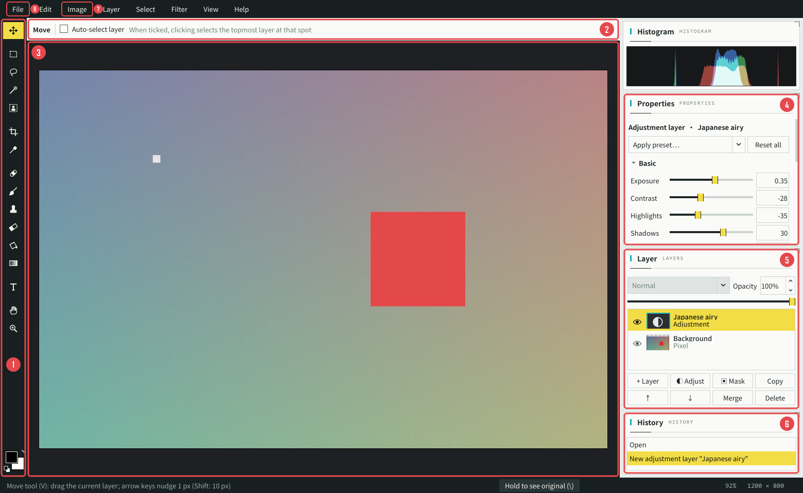
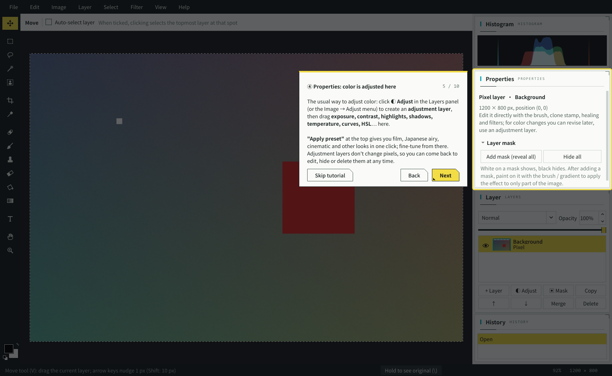

# Editor beginner tutorial

> New to PhotoCrate's editor? Spend five minutes on this page and you'll know where the everyday tools are.
> The app has the same walkthrough built in: it starts automatically the first time you open the editor, and you can replay it any time from **Help → Beginner Tutorial**.

**Relax first**: editing never changes your original photo. If something goes wrong, press **Ctrl+Z**; if you don't like any of it, just close the window and choose **Don't save** — nothing happened.

> This page describes the English interface. To switch languages: **Settings → Appearance → 界面语言 · Language**, then restart.
> 中文版教程：[修图新手教程.md](修图新手教程.md)

---

## 1. Opening the editor

Any of these works:

1. Go to **05 Culling** in the left navigation, select a photo in the grid, and click **Edit…** at the top;
2. Right-click a thumbnail on any page → **Edit (layers / adjustments / retouch)…**;
3. Press **E** in the full-screen viewer.

Videos can't be edited. RAW-only photos open too (using the camera's embedded full-size preview).

---

## 2. What's in the window

| # | Area | What it's for |
|---|---|---|
| ① | **Toolbar** (the strip on the far left) | All tools. Hover over an icon to see its name and how to use it. The two squares at the bottom are the **foreground / background colors**; click to change them |
| ② | **Options bar** (along the top) | Settings for the current tool: brush size, hardness and opacity; crop ratio, straighten angle… |
| ③ | **Canvas** (center) | Your photo. Scroll to zoom, hold Space and drag to move around |
| ④ | **Properties** (top right) | Settings of the selected layer. **All the color sliders live here** |
| ⑤ | **Layers** (middle right) | All layers, the eye (show / hide), blend mode, opacity, and buttons to add / copy / delete layers |
| ⑥ | **History** (bottom right) | Every step you've taken; click a row to go back to that step |
| ⑦ | **Image** and other menus | Adjustments, filters, selection, rotation, image size and more |
| ⑧ | **File** menu | Export image, save project |

The **Histogram** in the top right shows the photo's brightness distribution; it warns "Shadows clipped / Highlights clipped" when large areas are pure black or pure white.

### The toolbar tools you'll use most

| Position | Tool | Shortcut | What it does |
|---|---|---|---|
| 1st | Move | V | Drag the current layer (added text, pasted images) |
| 2nd–5th | Marquee / Lasso / Magic Wand / Object Selection | M / L / W / Q | Mark out an area so the next operations only affect it. **Object Selection** is the easiest: draw a box around a person or object and it's selected along its edges |
| 6th | Crop | C | Cut away extra parts, straighten a tilted horizon |
| 8th | Spot Healing Brush | J | Paint over spots, dust or wires and they're gone |
| 9th | Brush | B | Paint with the foreground color; painting on a mask controls where an effect shows |
| 10th | Clone Stamp | S | Alt+click to sample a spot, then paint it somewhere else |
| 11th | Eraser | E | Erase to transparency |
| T icon | Text | T | Add text to the photo |

---

## 3. The three things you'll do most

### 1. Adjust color (the most common)

1. Click **◐ Adjust** in the Layers panel (or the **Image → Adjust** menu). An "Adjustment" layer appears in the layer list.
2. A set of sliders appears in **Properties** on the right:
   - **Basic**: Exposure (overall brightness), Contrast, Highlights (darken the sky), Shadows (lift dark areas)
   - **Color**: Temperature (cooler / warmer), Tint, Vibrance, Saturation
   - Further down: **Curves, HSL (adjust one color on its own), Clarity, Sharpen, Noise Reduction, Vignette, Grain**…
3. Not sure where to start? Click **Apply preset…** at the top of Properties and pick **Japanese airy, Film, Cinematic, High-contrast B&W**, etc. for an instant look, then fine-tune a few sliders.
4. To compare before / after: **hold the `\` key** (or the **Hold to see original** button at the bottom right); release to go back.

> Adjustment layers never change the photo itself. Effect too strong? Lower the layer's **Opacity** at the top of the Layers panel; don't want it any more? Click the eye to hide it, or delete it.
> Double-click the name to the left of a slider to reset that slider.

### 2. Remove blemishes

- **Small things** (spots, sensor dust, thin wires): select the bottom **Background** layer in the Layers panel, press **J**, and paint over the blemish — it's patched when you release. Adjust the brush size in the options bar; slightly larger than the blemish works best.
- **Big things** (passers-by, trash cans): press **L** and draw around it with the Lasso (a little generously), then **Edit → Content-Aware Fill** (Shift+Backspace). If the result isn't good, Ctrl+Z and try a different outline, or touch up with the healing brush.
- **Regular textures** (walls, grass, water): use the Clone Stamp **S**: Alt+click a clean area, then paint over what you want to cover.

### 3. Crop and straighten

1. Press **C** and a crop box appears.
2. Choose a **Ratio** in the options bar (1 : 1 for avatars and social posts, 4 : 3 or 16 : 9 for landscape shots), or keep **Free**.
3. Drag the edges and corners to resize; drag inside the box to move it.
4. Tilted horizon? **Hold Ctrl and drag a line along the horizon** — it straightens automatically when you release. You can also drag the **Straighten** slider in the options bar.
5. Press **Enter** (or double-click inside the box) to finish. Not happy? Ctrl+Z.

---

## 4. A little more

### Adjust only part of the photo (e.g. brighten just a face)

1. Press **Q** and box the person with Object Selection (or draw an area with M / L). The flashing dashed line is the selection.
2. Click **◐ Adjust** to create an adjustment layer — the selection automatically becomes the layer's **mask**, so the adjustment only affects the selected area.
3. Edges too hard? Use **Select → Feather…** (Shift+F6) before creating the adjustment layer.

Mask rule: **white = effect on, black = effect off**. Click the mask thumbnail on the layer, then paint on the photo with a black brush to remove the effect where you paint.

### Add text

Press **T**, click on the photo, then type the text and choose the font, size and color in the dialog. You can add an **outline** and a **shadow**. Text can be changed any time: select the text layer and edit it in Properties on the right, or click it again with the Text tool.

### Cut-outs and compositing

1. Press **Q** to box the subject, then **Ctrl+J**: the subject is copied to a new layer.
2. **File → Place Image (as a new layer)…** (or copy an image elsewhere and press **Ctrl+V**) to bring in another picture.
3. **Ctrl+T** free transform: drag the corners to scale, drag outside the box to rotate, Enter to apply.
4. Use ↑ ↓ in the Layers panel to change the stacking order.

---

## 5. Saving: two ways, pick what you need

| | Export image | Save project |
|---|---|---|
| Menu | File → Export Image… | File → Save Project |
| Shortcut | Ctrl+Shift+S | Ctrl+S |
| You get | An ordinary JPG / PNG / TIFF / WebP | A `.pcedit` file that keeps all layers |
| Saved to | Next to the original by default, as "name_edited.jpg" | Next to the original, as "name.pcedit" |
| Good for | Finished — ready to post, print or share | Not finished yet — you'll keep editing later |

- Export **keeps the capture time, camera and other info** by default, so exported photos still sort by date and place; tick **Remove GPS location** when posting online.
- When you export into a folder in your library, the app rescans automatically and the new photo shows up right away.
- Next time you edit the same photo and a project file exists, you'll be asked whether to **Open project** and continue, or **Open original** and start fresh.

---

## 6. Troubleshooting

- **The brush does nothing?** Check whether the selected layer is an **adjustment layer** (it has no pixels; you can only paint on its mask), or whether the layer is hidden (eye off). Select **Background**, or click **+ Layer** to create one, and paint again.
- **Lost track and want to go back?** Look at **History** at the bottom right; click the top row, **Open**, to return to how the photo was when you opened it.
- **Picture too big / too small?** **Ctrl+0** fits the window, **Ctrl+1** shows 100% detail, the mouse wheel zooms around the cursor.
- **Can't remember shortcuts?** Press **F1** for the full list; each tool's shortcut is also in its tooltip.
- **Want to see the walkthrough again?** **Help → Beginner Tutorial**.

## 7. Shortcut cheat sheet (the 12 you'll use most)

| Key | Action | Key | Action |
|---|---|---|---|
| Ctrl+Z | Undo | Ctrl+Shift+Z | Redo |
| Space (hold) | Drag the view | Mouse wheel | Zoom |
| `\` (hold) | See the original | Ctrl+0 / Ctrl+1 | Fit window / 100% |
| [ / ] | Smaller / larger brush | X | Swap foreground / background color |
| Ctrl+J | Layer via copy (only the selection, if there is one) | Ctrl+T | Free transform |
| Ctrl+D | Deselect | Ctrl+Shift+S | Export image |
