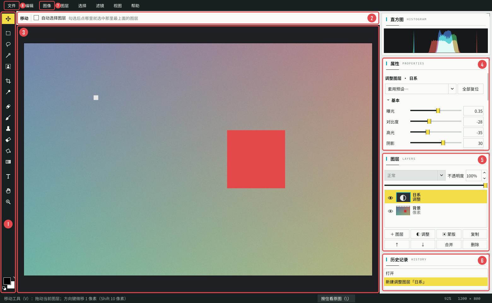
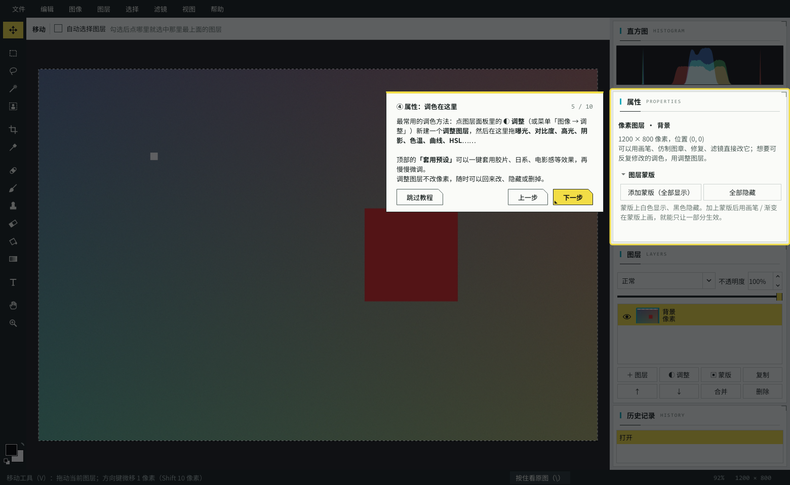
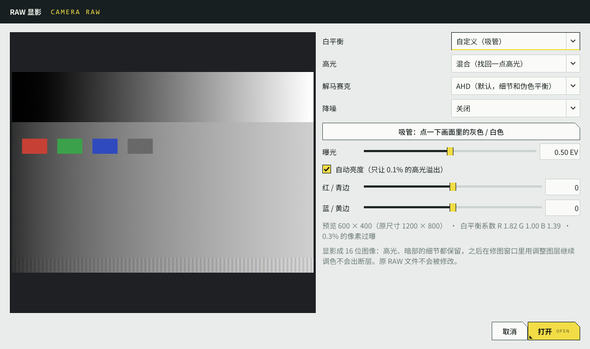
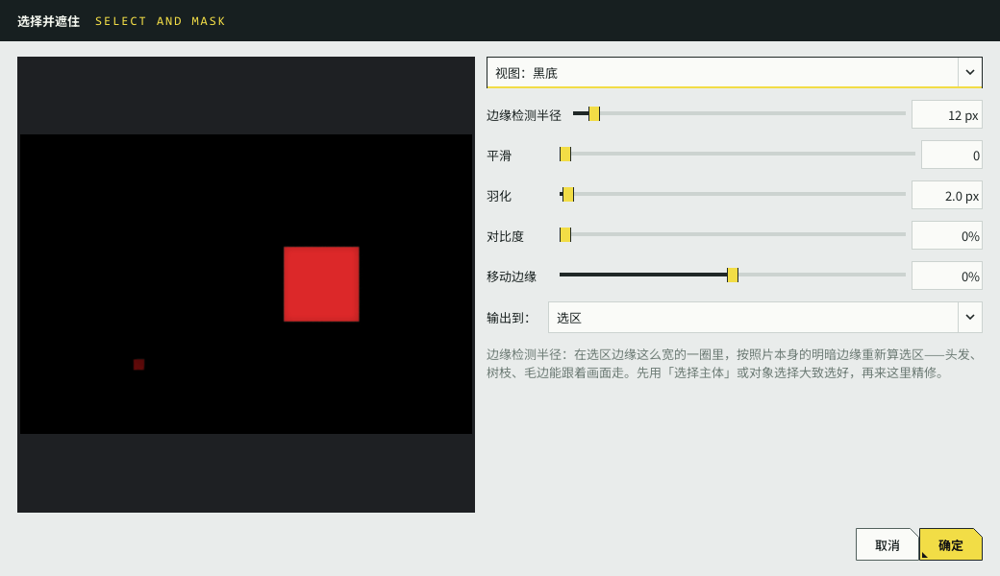
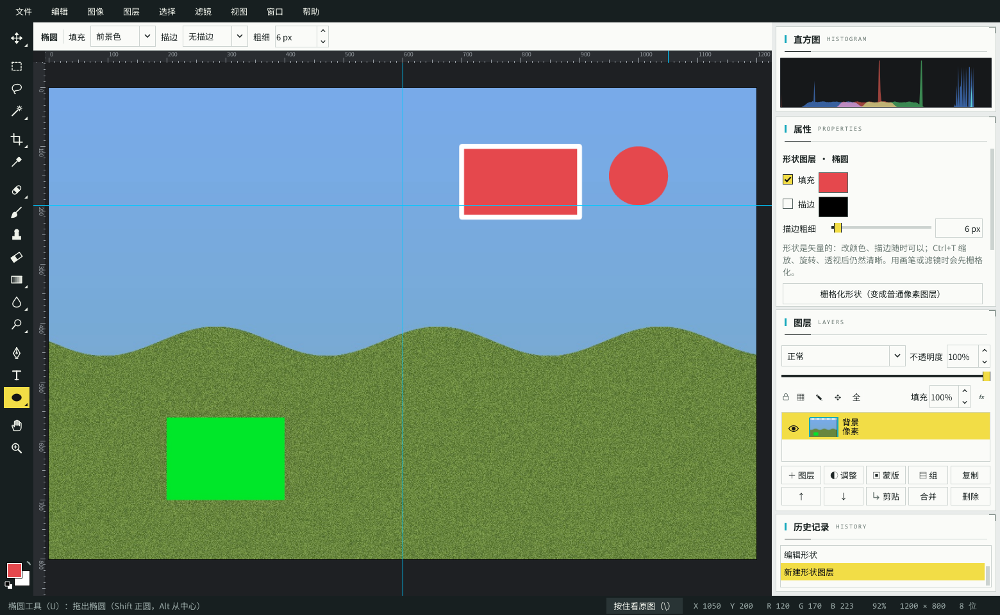

# 修图新手教程

> 第一次用影匣的修图？花 5 分钟看完这一页，就知道最常用的功能都在哪里。
> 软件里也有一样的引导：第一次打开修图窗口会自动出现，以后可以从 **帮助 → 新手教程** 重看。

**先吃一颗定心丸**：修图时原片永远不会被修改。改坏了按 **Ctrl+Z** 撤销；就算全都不满意，直接关掉窗口选“不保存”，什么都没发生过。

---

## 一、怎么打开修图

三种方式都可以：

1. 左侧导航进入 **05 挑片**，在下面选中一张照片，点上方的 **修图…** 按钮；
2. 在任何页面的缩略图上 **右键 → 修图（图层 / 调整 / 修复）…**；
3. 看大图时按键盘上的 **E**。

视频不能修图。只有 RAW 的照片也能打开（用的是相机内嵌的全尺寸预览）。

---

## 二、窗口里都有什么

| 编号 | 区域 | 用来做什么 |
|---|---|---|
| ① | **工具栏**（最左边一竖条） | 所有工具。鼠标停在图标上会显示名字和用法。最下面两个方块是**前景色 / 背景色**，单击可以改颜色 |
| ② | **选项栏**（顶上一横条） | 当前工具的设置：画笔的大小、硬度、不透明度；裁剪的比例、拉直角度…… |
| ③ | **画布**（中间） | 你的照片。滚轮放大缩小，按住空格拖动画面 |
| ④ | **属性**（右上） | 选中的图层的参数。**调色的滑块都在这里** |
| ⑤ | **图层**（右中） | 所有图层、眼睛（显示 / 隐藏）、混合模式、不透明度，以及新建 / 复制 / 删除图层的按钮 |
| ⑥ | **历史记录**（右下） | 做过的每一步，点哪一行就回到那一步 |
| ⑦ | **图像** 等菜单 | 调整、滤镜、选择、旋转、图像大小等更多功能 |
| ⑧ | **文件** 菜单 | 导出图片、保存工程 |

右上角的**直方图**显示照片的明暗分布；有大片死黑或死白时会提示“暗部溢出 / 高光溢出”。

### 工具栏里最常用的几个

| 图标位置 | 工具 | 快捷键 | 干什么用 |
|---|---|---|---|
| 第 1 个 | 移动 | V | 拖动当前图层（加的文字、贴进来的图） |
| 第 2–4 个 | 选框 / 套索 / 魔棒（同一格里还有对象选择）| M / L / W | 圈出一块区域，之后的操作只对这块生效。**对象选择**最省事：框住一个人或物体，自动沿边缘选出来 |
| 第 5 个 | 裁剪 | C | 裁掉多余部分，拉直歪掉的地平线 |
| 第 7 个 | 污点修复画笔（同一格还有修补、红眼）| J | 涂一下，痘痘、灰尘、电线就没了 |
| 第 8 个 | 画笔 | B | 用前景色画；在蒙版上画可以控制效果出现在哪 |
| 第 9 个 | 仿制图章 | S | 先按住 Alt 点一下“取样”，再把那里的画面画到别处 |
| 第 10 个 | 橡皮擦 | E | 擦成透明 |
| 第 12、13 个 | 模糊 / 锐化 / 涂抹，减淡 / 加深 / 海绵 | R / O | 局部磨皮、锐化，局部提亮、压暗（右键或 Shift+R / Shift+O 换工具） |
| T 形图标 | 文字 | T | 在照片上加字 |

---

## 三、三个最常用的操作

### 1. 调色（最常用）

1. 点图层面板里的 **◐ 调整**（或菜单 **图像 → 调整**）。图层列表里会多一个“调整”图层。
2. 右边 **属性** 里出现一排滑块：
   - **基本**：曝光（整体亮暗）、对比度、高光（压暗天空）、阴影（提亮暗部）
   - **颜色**：色温（偏冷 / 偏暖）、色调、自然饱和度、饱和度
   - 再往下还有**曲线、HSL（单独调某一种颜色）、清晰度、锐化、降噪、暗角、颗粒**……
3. 不知道怎么调？点属性顶上的 **「套用预设…」**，选**日系、胶片、电影感、黑白**等，一键出效果，再微调几个滑块。
4. 想对比修前修后：**按住键盘上的 `\` 键**（或右下角的“按住看原图”），松开恢复。

> 调整图层不会改动照片本身。觉得效果太重？把图层面板上方的**不透明度**调低就行；不想要了直接点眼睛隐藏或删掉。
> 双击滑块左边的名字，可以把这一项恢复成默认值。

### 2. 去掉瑕疵

- **小东西**（痘痘、传感器灰尘、细电线）：在图层面板里选中最下面的「背景」，按 **J**，在瑕疵上涂一下，松开就补好了。选项栏可以调笔刷大小，比瑕疵稍大一点效果最好。
- **大东西**（路人、垃圾桶）：按 **L** 用套索把它圈起来（圈得稍大一点），然后菜单 **编辑 → 内容识别填充**（Shift+Backspace）。效果不理想就 Ctrl+Z，换个圈法再试，或者用修复画笔补几下。
- **有规律的纹理**（墙面、草地、水面）：用仿制图章 **S**：按住 Alt 在干净的地方点一下，再去涂要盖住的地方。

### 3. 裁剪和拉直

1. 按 **C**，照片上出现裁剪框。
2. 选项栏 **比例** 选你想要的（1 : 1 适合头像和朋友圈，4 : 3、16 : 9 适合横图），或者保持“自由”。
3. 拖动框的边和角调整大小，在框里拖动可以移动位置。
4. 地平线歪了？**按住 Ctrl，沿着地平线拖一条线**，松开就自动拉直；也可以直接拖选项栏的“拉直”滑块。
5. 按 **回车**（或双击框内）完成。不满意按 Ctrl+Z。

---

## 四、再多学一点

### 只调一部分（比如只提亮人脸）

1. 按 **W**（再按 Shift+W 切到对象选择）框住人（或用 M / L 圈出区域），出现闪动的虚线 = 选区。
2. 点 **◐ 调整** 新建调整图层 —— 选区会自动变成这个图层的**蒙版**，调整只作用在选中的地方。
3. 边缘太生硬？先 **选择 → 羽化**（Shift+F6）再建调整图层。

蒙版的规则：**白色 = 生效，黑色 = 不生效**。点图层上的蒙版缩略图后，用黑色画笔在照片上涂，就能把涂到的地方的效果去掉。

### 加文字

按 **T**，在照片上单击，在弹出的窗口里输入文字、选字体、字号、颜色，可以加**描边**和**投影**。文字以后随时能改：选中文字图层，在右侧属性里改，或者用文字工具再点一下。

### 抠图、合成

1. 用对象选择（**W**，Shift+W 切换）框住主体，按 **Ctrl+J**：主体被复制到一个新图层上。
2. **文件 → 置入图片**（或从别处复制图片后 **Ctrl+V**）把另一张图放进来。
3. **Ctrl+T** 自由变换：拖角缩放、在框外拖动旋转，回车确定。
4. 在图层面板里用 ↑ ↓ 调整上下顺序。

### 合并曝光（HDR）：几张不同曝光合成一张

逆光、日落、室内拍窗外——天空亮、地面暗，一张照片怎么调都顾不全。拍的时候用相机的**包围曝光**（AEB）连拍 3 张（比如 −2 / 0 / +2 EV），回来让影匣合成一张：天空的云、暗处的细节都在，曝光正常。

1. 在 **05 挑片** 里按住 Ctrl 单击，选中这几张，点 **合并曝光…**（或在缩略图上 **右键 → 合并曝光（HDR，3 张）…**）。不在照片库里的照片：修图窗口 **文件 → 合并曝光（HDR）…** 直接选电脑上的文件。
2. 对话框里一般什么都不用改，点 **开始合并**：
   - **参考帧**：自动选曝光居中的那张。它不会被重新取样，清晰度原样保留；画面里动过的东西以它为准。
   - **去除重影**：标准。行人、树叶、水面在几张之间动过的地方只用参考帧，不会出现半透明的“鬼影”。
   - **自动对齐**：手持拍的几张会有一点错位，自动对齐到 0.1 像素左右；三脚架拍的没动，就完全不重新取样。
   - **保留各张源图为隐藏图层**：开着，后面修补重影要用。
3. 合并完，结果直接在修图窗口里打开。图层面板最上面是「合并结果」，下面是对齐后的每一张（参考帧那张可见，其余隐藏）。按住 `\` 看到的就是参考帧原图，方便对比。
4. 接着像平常一样调色、修图，最后 **导出图片**（默认叫「参考帧原名_HDR.jpg」）或 **保存工程**。

**还看得到重影？** 用套索 **L** 把那块圈出来（圈大一点），**图像 → 修补重影（从某一张源图取）…**，对话框里每张源图都有一张“补上之后的样子”的预览，点一张看着最干净的，再点 **补上**。补丁放在一个新图层上、带蒙版，亮度自动匹配到合并结果；边缘不自然可以用画笔在蒙版上修，不要了就删掉这一层。预览下面写着“这里过曝 / 欠曝，没有细节”的那张不要选。

> 小贴士：尽量用三脚架或者稳住手，用相机的连拍包围曝光（几张之间间隔越短，动的东西越少）。只有 RAW 的照片用相机内嵌的全尺寸预览参与合并。

### 专业修图：RAW、16 位、图层组、变换、修饰工具

**RAW 显影。** 只有 RAW 的照片点「修图…」时，先弹出 **RAW 显影** 窗口：白平衡（拍摄时设置 / 自动 / 日光，或点 **吸管** 再点一下画面里本来是灰色的地方）、曝光、高光（选「重建」能找回一部分过曝的天空）、降噪。左边是预览，满意了点 **打开**，得到的是 **16 位** 图像。有 JPG 也有 RAW 的照片照常打开 JPG；想用 RAW 的宽容度，菜单 **文件 → 重新显影 RAW…**，结果作为新图层放进来。

**16 位。** 标题栏写着“（16 位）”时，大幅拉曲线、色阶也不容易出断层（天空、皮肤的渐变）。普通 JPG 打开是 8 位，要大调色前可以 **图像 → 模式 → 16 位/通道**。导出 PNG / TIFF 时勾选“保存为 16 位”，给其他软件接着调。

**图层组。** 图层多了：选中一个图层按 **Ctrl+G** 放进组里，组前面的小三角可以折叠。**Ctrl+[ / Ctrl+]** 上下移动时会移进 / 移出组。组的混合模式默认「穿透」；改成「正常」后，组里的调整图层就只调组里的图层。

**剪贴蒙版（只调这一层）。** 想让一个调整图层只调下面那一张贴进来的图：选中调整图层，按 **Ctrl+Alt+G**（或图层面板的「剪贴」），它会往右缩进、带一个折角箭头。普通图层也可以剪贴：比如把一张纹理只显示在下面文字的笔画里。

**斜切、扭曲、透视、变形。** **Ctrl+T** 之后，在选项栏的「变换方式」里选：
- **透视**：拖一个角，同一条边上的另一个角对称地动——把拍歪的建筑拉正，或把图片贴到斜着的墙上
- **扭曲**：四个角随便拖（自由变换里按住 Ctrl 拖角也是扭曲，按住 Ctrl 拖边是斜切）
- **变形**：出现 4×4 的网格，拖任意一个点把图层弯过去
回车应用，Esc 取消。

**减淡 / 加深 / 海绵（O）、模糊 / 锐化 / 涂抹（R）。** 工具栏上这两格右下角有小三角：右键换工具，或按 **Shift+O / Shift+R** 轮换。人像常用：减淡（范围「中间调」、曝光度 15–25%）提亮眼睛，加深压暗轮廓；模糊磨皮；锐化点一下睫毛。

### 抠头发、换颜色、修脸型：第二批进阶功能

**选择并遮住（抠头发）。** 先用 **选择 → 选择主体** 或对象选择 **W** 大致选出人，再 **选择 → 选择并遮住…**（Ctrl+Alt+R）：把「边缘检测半径」拉到 10–30，头发丝、毛边就会跟着照片自己的边缘走；预览选「叠加」时红色是没选中的部分。输出选「新建带有图层蒙版的图层」最方便，原图不受影响。

**色彩范围。** 想只调画面里的某种颜色（比如只改天空的蓝）：**选择 → 色彩范围…**，在预览图上点一下天空（按住 Shift 再点几处）、调「颜色容差」，确定后新建调整图层，就只作用于选中的颜色。

**快速蒙版（Q）。** 按 **Q**，没选中的地方盖上一层红色；用画笔涂白色加选、涂黑色减选，再按 Q 变回选区——比用套索一点点抠更直观。常用的选区可以 **选择 → 存储选区…** 存起来，以后「载入选区」取回。

**新调整。** **图像 → 调整** 里多了 **黑白**（分别控制每种颜色变成灰色后的明暗，做黑白片比直接去色好看得多）、**色彩平衡**、**可选颜色**、**照片滤镜**、**通道混合器**、**渐变映射**。

**修补和红眼。** 工具栏修复画笔那一格（右键或 Shift+J）：**修补**——圈住要去掉的东西，拖到旁边干净的地方松开；**红眼**——在红眼上点一下。

**液化（瘦脸、理顺头发）。** **滤镜 → 液化…**（Ctrl+Shift+X）：选「向前变形」，笔刷比要推的部位大一点、压力 20–40%，轻轻推几下；推过头了用「重建」涂回来。

**镜头校正。** **滤镜 → 镜头校正…**：「移去扭曲」修广角的桶形畸变，「暗角数量」提亮四角，色差滑块去掉树枝边缘的紫边 / 绿边。

**图层样式。** 选中文字或抠出来的图层，点图层面板的 **fx**：勾选投影、描边、外发光……画布上马上看到效果，以后还能改。把「填充」调到 0%，就只剩描边 / 投影，文字本身变透明。图层面板上的锁可以锁住位置或像素，防止误改。

### 设计与效率：钢笔、形状、智能对象、参考线、动作、全景、印刷

**形状和钢笔。** 按 **U** 选矩形 / 椭圆等工具，拖一下就是一个形状图层：颜色、描边在右边属性里随时改，放大缩小不会糊（适合做海报、加标注）。按 **P** 用钢笔：单击加点、按住拖出曲线、点回起点闭合，选项栏「建立选区」就能沿曲线精确抠图。

**智能对象。** 要反复缩放一张贴进来的图？先「图层 → 智能对象 → 转换为智能对象」：之后怎么缩放都从原图重新算，滤镜也会变成能改、能关的“智能滤镜”。

**参考线。** **Ctrl+R** 打开标尺，从标尺上往画面里拖就是一条参考线；移动图层时会自动吸附到参考线、画面边缘和中线，方便居中对齐。

**动作和批处理。** 一组照片要做同样的处理（比如缩到长边 2048 再锐化）：**窗口 → 动作**，「新建并录制」后对一张照片做一遍，「停止录制」；然后点「批处理…」选上其他照片，一次全部处理好，结果存到另一个文件夹。

**全景和景深合成。** **文件 → 自动 → Photomerge**：选几张转着拍的照片（相邻的重叠 1/3），自动拼成全景并裁掉空白的边。微距、产品照对焦不够深时，用「景深合成」把对焦在前、中、后的几张合成一张全部清晰的。

**印刷。** **视图 → 校样颜色**（Ctrl+Y）预览印出来的颜色，**色域警告**（Ctrl+Shift+Y）把印不出来的颜色标成灰色；导出 JPEG / TIFF 时勾选「转换为 CMYK」交给印刷厂。要给用 Photoshop 的人：**文件 → 导出 → 存储为 PSD**。

**天空替换。** **编辑 → 天空替换…**：自动找出天空换成黄昏、晴空等（或你自己的天空照片），前景的色调会跟着协调；结果在一个组里，蒙版和位置都能再改。

---

## 五、保存：两种方式，按需选

| | 导出图片 | 保存工程 |
|---|---|---|
| 菜单 | 文件 → 导出图片 | 文件 → 保存工程 |
| 快捷键 | Ctrl+Shift+S | Ctrl+S |
| 得到什么 | 一张普通的 JPG / PNG / TIFF / WebP | 一个 `.pcedit` 文件，保留所有图层 |
| 存在哪 | 默认在原片旁边，叫「原名_修图.jpg」 | 原片旁边，叫「原名.pcedit」 |
| 适合 | 修好了，要发朋友圈、打印、分享 | 还没修完，以后还要接着改 |

- 导出时默认**保留拍摄时间、相机等信息**，所以导出的照片照样能按日期、地点分区；要发到网上可以勾选“去掉 GPS 位置”。
- 导出到照片库的文件夹里时，软件会自动重新扫描，新照片马上出现在照片库里。
- 下次打开同一张照片修图时，如果有工程文件，会问你要“打开工程”接着改，还是从原片重新开始。

---

## 六、遇到问题

- **画笔涂了没反应？** 看看图层面板里选中的是不是**调整图层**（调整图层没有像素，只能在它的蒙版上画）；或者这个图层被隐藏了（眼睛没亮）。选中「背景」或点 **＋ 图层** 新建一个再画。
- **改乱了不知道怎么回去？** 看右下角的**历史记录**，点最上面的“打开”就回到刚打开时的样子。
- **画面太大看不全 / 太小看不清？** **Ctrl+0** 适合窗口，**Ctrl+1** 看 100% 细节，滚轮以鼠标为中心缩放。
- **快捷键记不住？** 按 **F1** 看全部快捷键；工具的快捷键也写在每个工具的提示里。
- **想再看一遍引导？** **帮助 → 新手教程**。

## 七、快捷键速查（最常用的 12 个）

| 按键 | 作用 | 按键 | 作用 |
|---|---|---|---|
| Ctrl+Z | 撤销 | Ctrl+Shift+Z | 重做 |
| 空格（按住） | 拖动画面 | 滚轮 | 缩放 |
| `\`（按住） | 看原图 | Ctrl+0 / Ctrl+1 | 适合窗口 / 100% |
| [ / ] | 笔刷变小 / 变大 | X | 交换前景 / 背景色 |
| Ctrl+J | 复制图层（有选区时只复制选区） | Ctrl+T | 自由变换 |
| Ctrl+D | 取消选区 | Ctrl+Shift+S | 导出图片 |
